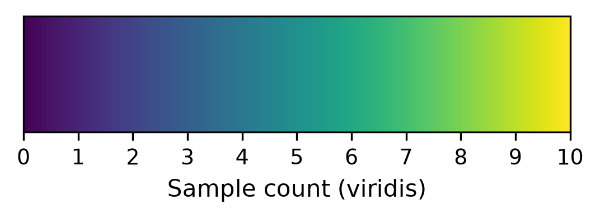

# Diagnostic group is aliased with source cohort — group contrasts are confounded with collection site

## Summary
In the 40-sample experimental subset (4 diagnostic groups × 10: ADD, PDD, PDCN, HCN), diagnostic group is almost perfectly aliased with the collection cohort/site. Bias-corrected Cramér's V for group × cohort is 0.515; it rises to 0.620 for the primary ADD-vs-other contrast and 0.828 for the secondary PD-vs-other contrast. Any protein that separates a diagnostic group from the others is therefore inseparable from a Kerchner-vs-Poston collection-site / batch effect.

## Verdict
This is the single most consequential design issue in the study. A feature that "distinguishes" ADD (or PD) could be a site/handling artifact rather than disease biology, and the two explanations cannot be pulled apart with the data as structured. Every downstream group-contrast finding must carry this caveat.

## Evidence
Diagnostic group and collection cohort/site are near-perfectly aliased, and the aliasing is worst for exactly the contrasts the study cares about: bias-corrected Cramér's V is 0.515 for group × cohort overall, 0.620 for the primary ADD-vs-other split (ADD is 10/10 Kerchner), and 0.828 for the secondary PD-vs-other split (PD is 17/20 Poston; Other is 17/20 Kerchner). The sample-count matrix shows why.

*Figure 1. Group × cohort/site sample-count matrix. Produced by `scripts/figures/plot_group_x_cohort_confound.py` (uncommitted) from data `sha256:62f10c7072fe613e`, with statistics from `results/confounding_stats.json` and counts from `results/crosstab_group_x_cohort.csv`.*

The matrix is near block-diagonal: ADD is entirely Kerchner (10/10), PDCN entirely Poston (10/10), PDD almost entirely Poston/PUC (7 Poston, 2 ADRC-PUC, 1 PUC-only), and only HCN spans both site clusters (7 Kerchner, 3 Poston). Diagnostic group is therefore almost perfectly aliased with collection site — any group contrast is inseparable from a site effect.

## Methods / how to produce
The confounding statistics (bias-corrected Cramér's V for group × cohort and for the primary/secondary pooled contrasts) are in `results/confounding_stats.json`; the group × cohort contingency counts are in `results/crosstab_group_x_cohort.csv`. The figure is rendered by `scripts/figures/plot_group_x_cohort_confound.py` (scratch) from `data/metadata.csv` (`sha256:62f10c7072fe613e`, mtime 2026-09-14), `results/confounding_stats.json`, and `state/color_registry.json`, restricted to the 40 experimental samples (8 pooled-reference controls excluded). See `provenance`.

## Discussion
When the covariate that defines the biological contrast is aliased with a technical/collection covariate, the two are not separately estimable: a marker that appears to distinguish ADD or PD from other groups is equally consistent with a Kerchner-vs-Poston site, batch, or handling artifact. The four-arm design offers partial leverage — a feature that also moves in PDD points to a dementia-generic or site effect rather than a disease-specific one, and a feature that tracks site across arms is suspect — but the aliasing cannot be dissolved by analysis alone.

## Caveats
This is a metadata (Stage 1) caveat recorded before the integrity gate; its `integrity_signoff` was certified at the Stage-3 integrity gate (signed off by Michael Riffle on 2026-09-15) for the certified `data_version`, and is now `true`. The evidence is descriptive (association statistics on the cohort as observed), not a hypothesis test, and makes no held-out claim — hence `phase: exploratory`.

**Mitigations to carry downstream:** (1) exploit the four-arm structure — check whether a candidate feature also separates PDD (dementia-generic) or tracks site rather than diagnosis; (2) run within-cohort checks where sample sizes allow — HCN is the only group that spans both site clusters, so it is the only within-group cross-site comparison available.

## Follow-ups
- Attach a `relates_to` edge from every downstream group-contrast discovery to this caveat so the confound travels into analysis and the final report's Limitations.
- Where feasible, add site as a modeled covariate or restrict to within-site comparisons, recognizing that full deconfounding is not possible with this design.

## Related findings
None yet. Downstream group-contrast discoveries should link here with a `relates_to` edge (§2.6). The collection-year skew caveat compounds this one (see that finding's `relates_to` edge into this record).

## References
None.
</content>
</invoke>
