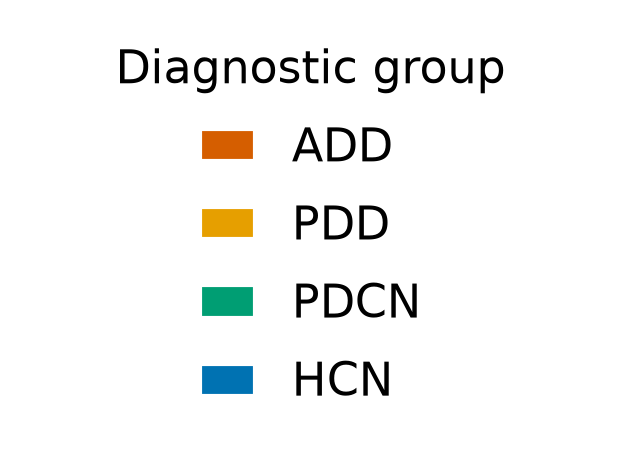

# Plasma collection year skews across diagnostic groups — differential storage time confounds group contrasts

## Summary
Across the 40 experimental samples (n=10/group), plasma collection year differs systematically by diagnostic group (Kruskal–Wallis p = 0.026). ADD was collected earliest (9/10 in 2013, 1 in 2012; median ~2013), PDCN/HCN center on ~2014, and PDD spreads widely into 2018–2021. Because collection year tracks the cohort split (see [finding 0001](0001-group-aliased-with-cohort.md)), storage/freezer time differs systematically across groups.

## Verdict
A secondary confound that compounds the dominant cohort/site confound: differential storage duration is partly aliased with diagnosis. Pre-analytical variation (storage time, freeze/thaw) can alter the plasma/EV proteome, so any group-associated protein must be checked against collection year / storage time before it can be read as disease biology.

## Evidence
The four groups differ in when their plasma was collected (Kruskal–Wallis p = 0.026 on collection year), and the difference lines up with diagnosis: ADD is the earliest and PDD the latest and most spread out.

*Figure 1. Collection year by diagnostic group. Produced by `scripts/fig_collection_year_by_group.py` (uncommitted) from data `sha256:62f10c7072fe613e`, with the group-difference statistic from `results/confounding_stats.json`.*

ADD plasma clusters tightly at 2013 while PDD/PDCN/HCN center on 2014, and PDD spreads into 2018–2021. Because collection year tracks diagnostic group, storage/freezer time differs systematically across groups — a secondary confound that can masquerade as biological signal.

## Methods / how to produce
Collection year is read per sample from `data/metadata.csv` (`sha256:62f10c7072fe613e`, mtime 2026-09-14), restricted to the 40 experimental samples (8 pooled-reference controls excluded). The Kruskal–Wallis statistic across the four groups is recorded in `results/confounding_stats.json` (`year_kruskal_p`). The figure is rendered by `scripts/fig_collection_year_by_group.py` (scratch) from `data/metadata.csv` and `state/color_registry.json`. See `provenance`.

## Discussion
Storage duration and freeze/thaw history are well-known pre-analytical sources of variation in plasma and extracellular-vesicle proteomics. Here that variation is not random with respect to diagnosis — it tracks the cohort split — so it adds a second layer of confounding on top of the site aliasing. A protein whose abundance changes with time in the freezer would appear to separate ADD (oldest samples) from the rest, mimicking a disease signal.

## Caveats
Metadata (Stage 1) caveat recorded before the integrity gate; its `integrity_signoff` was certified at the Stage-3 integrity gate (signed off by Michael Riffle on 2026-09-15) for the certified `data_version`, and is now `true`. The Kruskal–Wallis test is a single descriptive test of the cohort as observed (no multiple-testing family, no correction applied) and makes no held-out claim — hence `phase: exploratory`. Collection year is used as a proxy for storage time; actual freeze/thaw history is not captured in the metadata.

## Follow-ups
- When evaluating any group-associated protein, test its association with collection year / storage time and report whether the group effect survives.
- Consider modeling collection year as a covariate where the design permits, recognizing it is partly aliased with both diagnosis and site.

## Related findings
- Compounds [finding 0001](0001-group-aliased-with-cohort.md) (`relates_to`): collection year tracks the same cohort split that aliases diagnostic group with collection site, so this storage-time skew stacks on top of that dominant confound.

## References
None.
</content>
