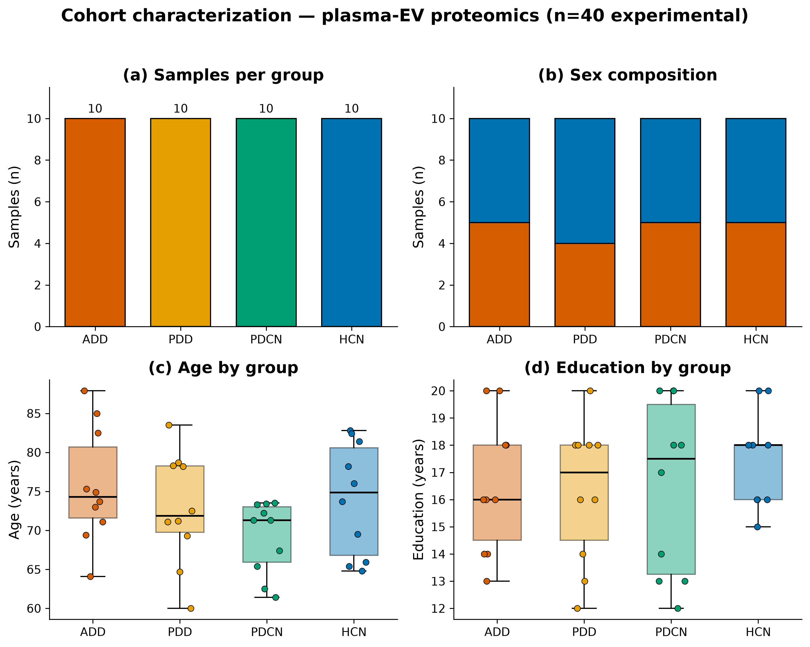
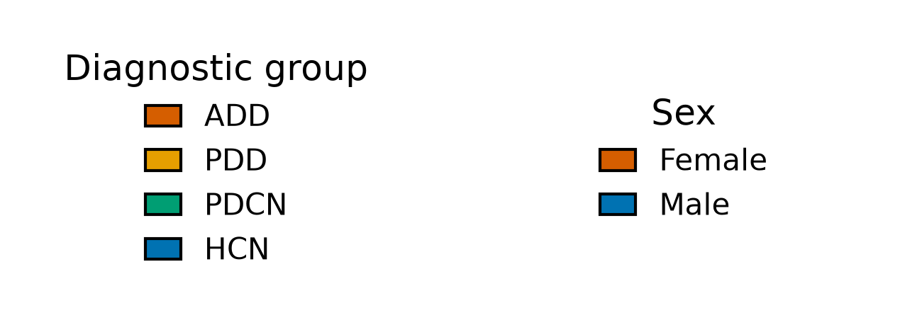

# Primary/secondary contrasts are class-imbalanced and small-n; pooled references absent from the data matrix

## Summary
The four diagnostic groups are perfectly balanced at n=10 each, but the analysis pools them into binary contrasts: the primary ADD-vs-others contrast is 10 vs 30 (25% positive, only 10 positives), and the secondary PD-vs-others (PD = PDD+PDCN) contrast is 20 vs 20. Separately, the 8 pooled-reference control samples present in the metadata are absent from the data matrix (`data/protein-data.csv` carries only the 40 experimental columns), so run drift / technical reproducibility cannot be assessed from the pooled references in this file.

## Verdict
Classification here demands imbalance-aware metrics (balanced accuracy / precision–recall / MCC, never bare accuracy), stratified cross-validation matched to the generalization target, and a mandatory label-shuffle null — the small n per positive class combined with high feature dimensionality makes overfitting/optimism risk severe. The absent pooled-reference data removes one drift-assessment lever; data availability should be confirmed at Stage 2/3.

## Evidence
The group design is balanced, but the *analysis* contrasts are not. Pooling the balanced 4×10 groups yields a 10-vs-30 primary contrast (25% positive) and a 20-vs-20 secondary contrast. The cohort characterization documents the balanced structure that becomes the imbalanced pooled contrast.

*Figure 1. Cohort characterization of the 40 experimental samples. Produced by `scripts/scratch/cohort_characterization.py` (uncommitted) from data `sha256:62f10c7072fe613e`.*

The four diagnostic groups are perfectly balanced at n=10, but the primary analysis pools three of them into "others", yielding a 10-vs-30 imbalanced contrast with only 10 positives — demanding imbalance-aware metrics, stratified CV, and a label-shuffle null.

Separately, the 8 pooled-reference controls (CP01–04 "Plasma Reference", KP01–04 "TPAD plasma pooled reference") appear in the metadata but not in the data matrix: `data/protein-data.csv` contains only the 40 experimental columns. This is a count/reconciliation observation and carries no figure — there is nothing to plot for an absent set of columns.

## Methods / how to produce
Group counts and the balanced 4×10 structure are read from `data/metadata.csv` (`sha256:62f10c7072fe613e`, mtime 2026-09-14); the pooled binary contrasts (ADD-vs-other = 10 vs 30; PD-vs-other = 20 vs 20) are the study's primary/secondary analysis contrasts. The pooled-reference absence is established by reconciling the metadata sample list against the columns of `data/protein-data.csv`. The characterization figure is rendered by `scripts/scratch/cohort_characterization.py` from `data/metadata.csv` and `state/color_registry.json`. See `provenance`.

## Discussion
A balanced group design does not guarantee a balanced classification problem: pooling into "one vs rest" is exactly where imbalance enters. With only 10 positives in the primary contrast and a high-dimensional proteomic feature space, accuracy is misleading and optimism from feature selection is large — which is why the label-shuffle null is not optional here (it is also the leakage check). The missing pooled-reference measurements are a distinct issue: those samples are the standard lever for assessing run drift and technical reproducibility, and without their protein data in this file that lever is unavailable.

## Caveats
Metadata (Stage 1) caveat recorded before the integrity gate; its `integrity_signoff` was certified at the Stage-3 integrity gate (signed off by Michael Riffle on 2026-09-15) for the certified `data_version`, and is now `true`. The evidence is descriptive (class-balance counts and a metadata-vs-matrix reconciliation), not a hypothesis test, and makes no held-out claim — hence `phase: exploratory`. Whether the pooled-reference protein data exists elsewhere is unresolved and should be confirmed at Stage 2/3 before concluding the drift lever is truly unavailable.

## Follow-ups
- Confirm at Stage 2/3 whether pooled-reference protein measurements exist in another file; if not, plan run-drift assessment without them.
- Fix imbalance-aware evaluation (balanced accuracy / average precision / MCC), stratified CV matched to the generalization target, and a label-shuffle null as standing requirements for every classifier finding.

## Related findings
- Relates to [finding 0001](0001-group-aliased-with-cohort.md) (`relates_to`): the imbalanced pooled binary contrast (ADD-vs-others / PD-vs-others) is constructed by pooling the same diagnostic groups that are aliased with collection site, so the imbalance and the site-confound act on the same partition.

## References
None.
</content>
