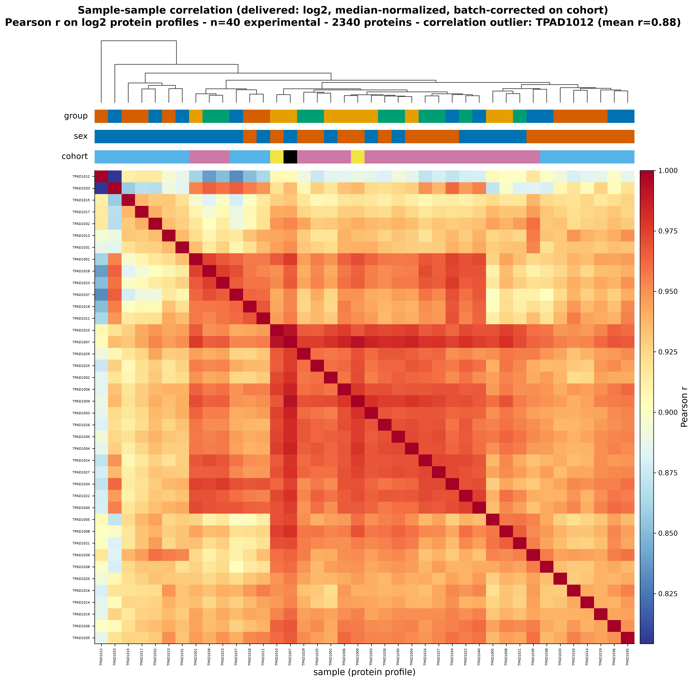
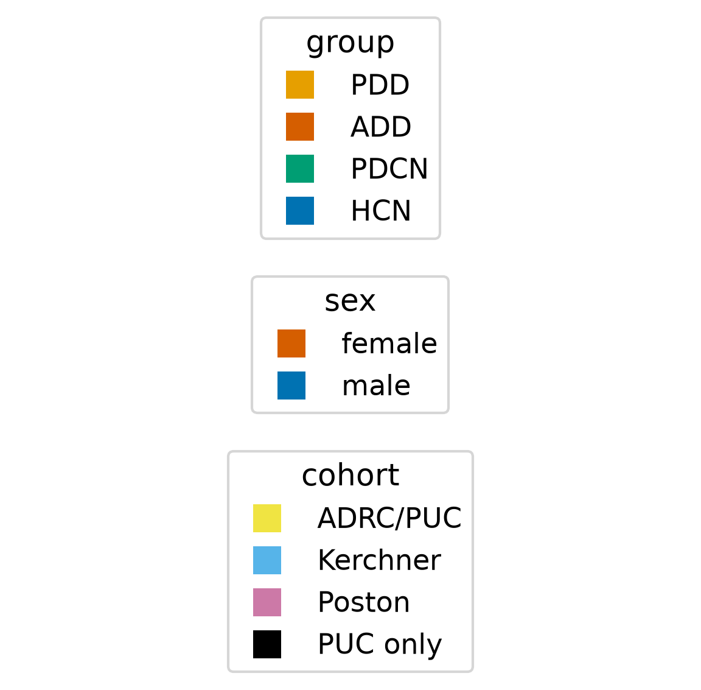

# TPAD1012 is a global sample-correlation outlier — retained in the analysis set but flagged for sensitivity analysis

## Summary
In the Stage-3 QC sample×sample correlation heatmap of the delivered (limma batch-corrected, log2) matrix, sample **TPAD1012** (group ADD, Male, Kerchner cohort) stands out as a global low-correlation outlier. Its mean off-diagonal Pearson r is 0.883 against a pack median of 0.944 — a MAD-based robust-Z of -5.02 — and it holds the lowest single pairwise correlation in the cohort (0.804). The separation is a clear singleton: the next-most-separated sample (TPAD1033) is only robust-Z -2.28. TPAD1012 is retained in the 40-sample analysis set but flagged for with/without sensitivity checks.

## Verdict
TPAD1012 is a genuine correlation-structure outlier, but it is **not** extreme enough to be obviously corrupt (its mean r sits ~0.06 below the pack, not off the scale). The scientist's decision at the integrity-gate sign-off (2026-09-15) is therefore to **keep** TPAD1012 in the 40-sample analysis set — n is small and there is no independent reason to drop it — while **flagging** it: any Stage-4 analysis that a single sample could disproportionately influence (PCA, clustering, classifiers, correlation-based statistics) should be run **with and without** TPAD1012, and any finding whose result is sensitive to that choice must say so. Because TPAD1012 is one of only 10 ADD samples, removing it would also worsen the 10-vs-30 class imbalance, so keep-but-flag also preserves the sample count.

## Evidence
TPAD1012 is a single, clearly separated low-correlation sample rather than one of a diffuse tail. Its mean off-diagonal Pearson r is 0.883 versus a pack median of 0.944 (MAD-based robust-Z = -5.02), it carries the lowest single pairwise r in the cohort (0.804), and the next-most-separated sample (TPAD1033) reaches only robust-Z -2.28. This was independently confirmed by the figure-reviewer, who recomputed the mean r at 0.883 and found the next-lowest sample at 0.914 — a singleton roughly 0.06 below the pack, and notably not extreme enough to look corrupt. The correlation heatmap makes the separation visible.

*Figure 1. Sample×sample correlation heatmap of the delivered matrix. Produced by `scripts/figures/plot_sample_correlation.py` (uncommitted) from data `protein-data.csv sha256:90a0462eb03a02bd`, input state `results/qc_states/delivered_log`.*

Each cell is the Pearson correlation between two samples over the 2340 log2 proteins, ordered by hierarchical clustering. The row/column for TPAD1012 reads as a consistently cooler band than the rest of the matrix — it correlates less well with essentially every other sample, not just a handful — which is exactly the signature of a *global* correlation outlier rather than a localized pairing artifact. That the band is a single sample, sitting well below an otherwise tight pack, is what makes it a flaggable singleton without being extreme enough to call corrupt.

## Methods / how to produce
Per-sample mean off-diagonal Pearson correlations (and the MAD-based robust-Z, the minimum pairwise r, and the ranking of samples) are computed over the delivered, limma batch-corrected, log2 matrix (40 experimental samples, 2340 proteins) held in `results/qc_states/delivered_log`; the 8 pooled-reference controls are excluded. The heatmap is rendered by `scripts/figures/plot_sample_correlation.py` from that input state. The independent recomputation was performed by the figure-reviewer during figure review (PASS). See `provenance`.

## Discussion
A global sample-correlation outlier matters most in small-n multivariate work: with only 40 samples — and only 10 ADD samples — a single atypical sample carries real leverage in PCA, clustering, and classifier training, and it distorts any correlation-based statistic it participates in. TPAD1012's separation is modest in absolute terms (~0.06 in mean r) but unambiguous in rank, which is the regime where a keep-but-flag policy is appropriate: dropping it is not justified on QC grounds alone, but analyses cannot be assumed robust to its inclusion. Recording it as a caveat is how that leverage is remembered into Stage 4 rather than rediscovered per-analysis.

## Caveats
This QC caveat rests on the same certified sample↔metadata pairing and delivered data that passed the Stage-3 integrity gate (signed off 2026-09-15), so `integrity_signoff` is `true` for the certified `data_version`. The evidence is descriptive (per-sample correlation summaries), not a hypothesis test, and makes no held-out claim — hence `phase: exploratory`. The keep-vs-drop decision is the scientist's, made at the integrity gate; this finding records that decision and the flag, it does not adjudicate it. Note that the delivered matrix is already batch-corrected, so TPAD1012's separation is over the corrected data — the outlier status is a property of the analysis-ready matrix downstream analyses will actually use.

## Follow-ups
- For every Stage-4 analysis that a single sample could influence (PCA, clustering, classifiers, correlation-based statistics), run the analysis **with and without** TPAD1012 and record whether the result is sensitive to it.
- Attach a `relates_to` edge from any Stage-4 discovery whose result proves sensitive to TPAD1012, so the sensitivity caveat travels into the report.

## Related findings
- Relates to [finding 0003](0003-contrasts-class-imbalanced-small-n.md) (`relates_to`): TPAD1012 is an ADD sample, so excluding it would further worsen the 10-vs-30 class imbalance recorded in [finding 0003](0003-contrasts-class-imbalanced-small-n.md); the keep-but-flag decision preserves the sample count.

## References
None.
</content>
</invoke>
