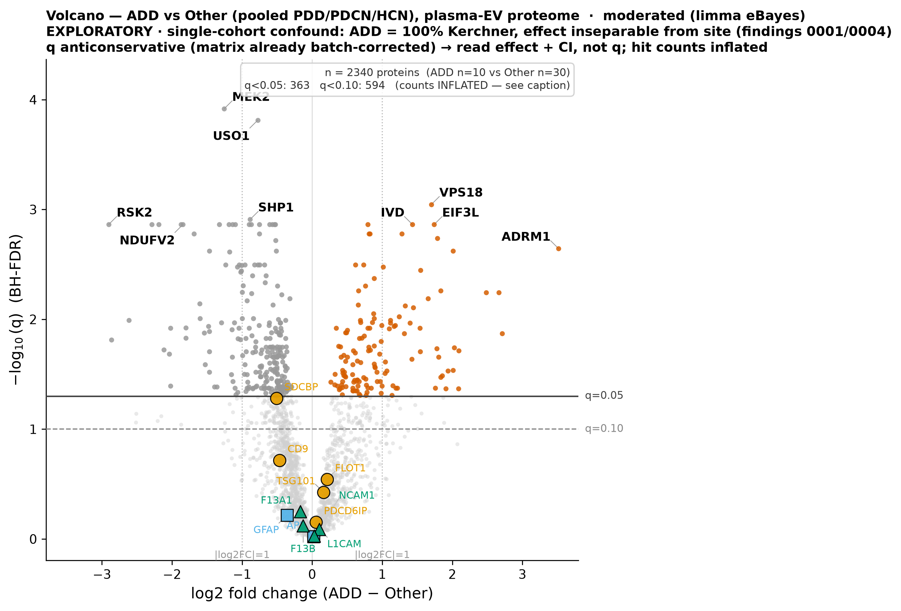
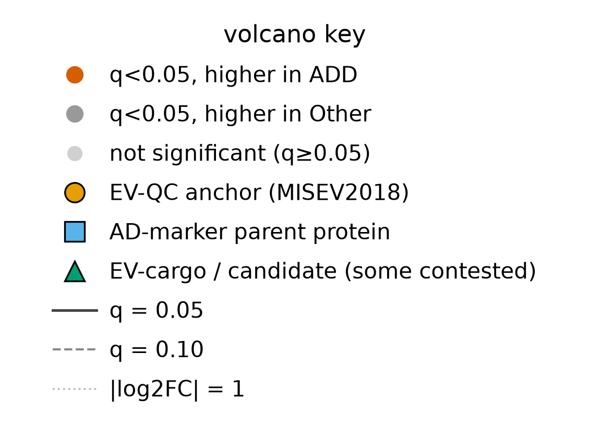
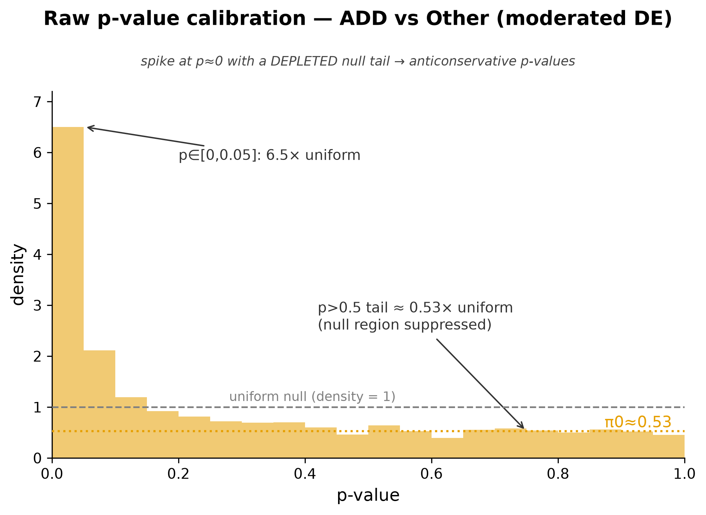
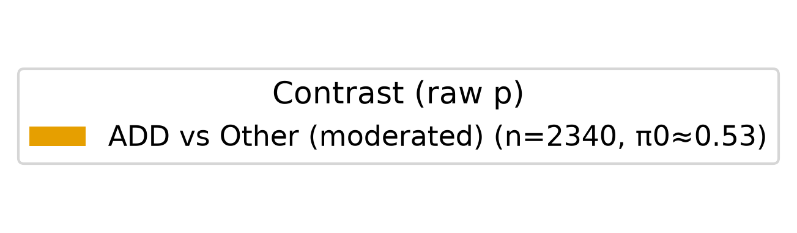

# ADD-vs-others differential abundance: a large but anticonservative, cohort-confounded hit list dominated by intracellular proteins — and no known plasma/EV AD marker is differential

## Summary
The primary Stage-4 contrast is a moderated (limma-style empirical-Bayes) linear model of **ADD (n=10)** vs a **pooled Other = {PDD, PDCN, HCN} (n=30)** group, run on the delivered 40×2340 log2 plasma-EV matrix (already median-normalized and batch-corrected on cohort). The effect is `log2FC = ADD − Other` with a 95% CI, raw p, and BH-q per protein. It returns **363 proteins at BH-q<0.05** (133 up in ADD, 230 down) and **594 at q<0.10**, over an effect range of log2FC **−2.90 … +3.52**. Two honesty observations dominate the reading: the strongest hits are **intracellular / organellar** proteins (kinases, proteasome, mitochondrial, vesicle-trafficking), not canonical secreted plasma or EV-cargo proteins; and **none of the known plasma/EV AD reference markers reaches significance**.

## Verdict
This is a large but fragile hit list. The p-value histogram shows the **anticonservative signature** — a spike at p≈0 with a *suppressed* null tail (π0≈0.53), not a clean U-shape — so the 363/594 hit **count is inflated**: read the effect sizes and CIs, not the q-values. The effect is also inseparable from an **ADD/Kerchner collection-site effect** (ADD is single-cohort, so no cohort covariate is possible; [finding 0001](0001-group-aliased-with-cohort.md)) and is computed on **already-batch-corrected data** whose variance is deflated ([finding 0004](0004-batch-correction-extrapolated-single-cohort.md)). It is strictly **hypothesis-generating**. The honest next tests are a **label-shuffle-nulled classifier** and **blinded / held-out replication**.

## Evidence
The contrast returns a large hit list with a wide effect range. 363 proteins clear BH-q<0.05 (133 up in ADD, 230 down) and 594 clear q<0.10; the top hits by q are all intracellular/organellar — MP2K2/MEK2 (log2FC −1.26, 95% CI [−1.64, −0.87], q=1.2e-4), USO1 (−0.78 [−1.02, −0.53]), VPS18 (+1.70 [1.10, 2.30]), PTN6/SHP1 (−0.89 [−1.21, −0.56]), TYPH (−1.32 [−1.85, −0.80]), EIF3L (+1.74 [1.05, 2.43]), IVD (+1.43 [0.85, 2.01]), KS6A3/RSK2 (−2.90 [−4.05, −1.76]), NDUV2/NDUFV2 (−1.84 [−2.60, −1.09]) — and the strongest single effect is the proteasome subunit **ADRM1 (+3.52 [2.00, 5.03], q=2.3e-3)**. These are kinases (MEK2, RSK2, SHP1), proteasome (ADRM1), mitochondrial (NDUFV2, IVD), and vesicle-trafficking (VPS18, USO1) proteins — the intracellular/organellar interior, not secreted or EV-cargo species.

The volcano shows both the size of the list and, crucially, where the known EV/AD markers land:

*Figure 1. Volcano of ADD vs pooled Other, moderated model. Produced by `scripts/figures/plot_volcano_add_vs_other.py` (uncommitted) from `results/differential_abundance/add-vs-other-moderated/contrast_table.csv`, data `sha256:90a0462eb03a02bd`.*

Each point is one of 2340 proteins, positioned by log2FC (x) against BH significance (y); the colored points above the q=0.05 line are the 363 hits, split by direction. The labeled extremes — MEK2, RSK2, ADRM1, NDUFV2 and the rest — are intracellular proteins, not EV cargo. The overlaid known plasma/EV AD markers all sit **at or below** the q=0.05 line: **none is significant** — CD9 (q=0.19), FLOT1 (0.29), TSG101 (0.38), ALIX (0.70), syntenin/SDCBP (0.052, the closest), GFAP (0.61), APP (0.95), L1CAM (0.82), NCAM1 (0.94), F13A1 (0.56), F13B (0.76). The reference panel is exactly where a null hypothesis would put it, which is what makes the intracellular-dominated hit list suspect as EV biology.

The calibration check is the main honesty diagnostic available without a null (no shuffle null is run for univariate DE):

*Figure 2. p-value calibration check. Produced by `scripts/figures/plot_pvalue_hist_add_vs_other.py` (uncommitted) from the same `contrast_table.csv`, data `sha256:90a0462eb03a02bd`.*

The first bin (p<0.05) stands at **6.5× uniform** — there is real small-p signal — but the null tail (p>0.5) is **depleted to ~0.53× uniform** (π0≈0.53). A well-calibrated mix of true nulls and true effects gives a flat tail at 1× with a spike; here the tail is *below* 1×, the anticonservative signature of variance deflation. Read this as: some genuine signal, but the BH hit **count is inflated** because the null is being under-counted — so effect sizes and CIs are the trustworthy currency, not the q-values.

## Methods / how to produce
Run `scripts/scratch/de_add_vs_other.py` (a call site for the project copy of the `differential-abundance` lib template, seeded from `lib/analysis/differential-abundance` @ 0.1) on the delivered analysis matrix `data/protein-data.csv` (`sha256:90a0462eb03a02bd`, 40 samples × 2340 tested features; controls already excluded and the yeast spike-in + two floored sentinels dropped upstream). The script builds the binary primary factor **ADD vs Other = {PDD, PDCN, HCN} pooled**, runs `differential_abundance(..., method="moderated")` with `reference="Other"` so `log2FC = ADD − Other`, and writes the full per-feature contrast table (effect + 95% CI + p + BH-q + mean abundance) to `results/differential_abundance/add-vs-other-moderated/contrast_table.csv` plus a JSON summary carrying the histogram calibration read and hit counts. **No cohort covariate** is fitted — ADD is 100% Kerchner, so Cohort is aliased with the contrast and the design would be rank-deficient. **No shuffle null** is run (that is the classifier/regressor discipline; the eBayes moderation is the variance control here). The environment is pinned by `uv.lock`; the analysis is deterministic (no RNG). Figures 1–2 are pure `load → plot` jobs over the cached `contrast_table.csv` (`scripts/figures/plot_volcano_add_vs_other.py`, `scripts/figures/plot_pvalue_hist_add_vs_other.py`); they recompute nothing.

**Not promotable as-is:** the analysis script is under `scripts/scratch/` (not code-reviewed, not promoted). This finding therefore **cannot be validated** until the script is reviewed and moved to `scripts/promoted/` (`conventions/findings.md` §2.2, §4).

## Discussion
The biology to be honest about is what the top of the list is *made of*. A plasma-EV proteomics contrast that is supposed to surface secreted or vesicle-cargo differences instead returns intracellular kinases (MEK2, RSK2, SHP1), a proteasome subunit (ADRM1, the single strongest effect), mitochondrial proteins (NDUFV2, IVD), and trafficking machinery (VPS18, USO1) — while the canonical EV/AD reference markers (CD9, FLOT1, TSG101, ALIX, syntenin, GFAP, APP, L1CAM, NCAM1) sit at the null. Read together with the anticonservative histogram and the single-cohort confound, the most parsimonious reading is that much of this list reflects site/processing structure and inflated significance rather than ADD EV biology. That does not make it worthless — there is real small-p signal — but it caps what may be claimed. (The marker-panel and EV-QC designations invoked here are background claims that require the research-reviewer's `references`; see Caveats and the report flag.)

## Caveats
- **Exploratory, small-n, imbalanced, confounded.** n=10 vs 30; the effect was derived on the same data it is observed in — the multiplicity context (this is the primary of several Stage-4 contrasts explored) is in `findings/exploration-log.md`. Never write this up with confirmatory confidence (`conventions/findings.md` §5).
- **Site confound (relates_to [finding 0001](0001-group-aliased-with-cohort.md)).** ADD is 100% Kerchner, so the ADD effect is inseparable from a collection-site effect and **no cohort covariate is possible** — adding Cohort makes the design singular (rank-deficient). Every ADD-specific claim must be qualified as inseparable from an ADD/Kerchner site effect.
- **Anticonservative p/q from batch-corrected input (relates_to [finding 0004](0004-batch-correction-extrapolated-single-cohort.md)).** The matrix is already `limma::removeBatchEffect`-corrected on Cohort; running inference on that output deflates within-feature variance, which is exactly the suppressed-null-tail signature in Figure 2. The ideal both-ways robustness check — uncorrected matrix with batch-as-covariate — is **impossible** because the pre-correction matrix is unavailable. Consequence: **the 363/594 hit count is inflated; trust effect sizes + CIs, not q-values.**
- **Entity ids** are the UniProt accessions carried in the contrast table's feature identifiers; the research-reviewer should confirm the symbol↔accession labels at promotion.

## Follow-ups
- Run a **label-shuffle-nulled classifier** (ADD vs Other) — the honest test that also serves as the leakage check the univariate DE cannot provide.
- Pursue **blinded analytic replication** and, for any `confirmatory` claim, **held-out / orthogonal data replication** (none available in-project yet).
- **Promote the analysis script** (`scripts/scratch/de_add_vs_other.py` → code review → `scripts/promoted/`) before any validation attempt.
- **Add and fact-check `references`** for the known plasma/EV AD marker panel and the MISEV2018 EV-QC / Nielsen-2021 candidate designations (research-reviewer).
- Read the ADD hits against the **four-arm structure** (is a top hit dementia-generic in PDD? does it track the HCN/site pattern?) to separate ADD-specific signal from site/processing structure.
- Normalize the full hit list into `entities` (only the named notable proteins and reference markers are captured here).

## Related findings
- **relates_to → [finding 0001](0001-group-aliased-with-cohort.md):** diagnostic group is aliased with source cohort. ADD is 100% Kerchner, so this contrast's effect is inseparable from a collection-site effect and no cohort covariate is admissible.
- **relates_to → [finding 0004](0004-batch-correction-extrapolated-single-cohort.md):** the matrix is already batch-corrected on cohort; DE on that output deflates variance and yields anticonservative p/q (the suppressed null tail of Figure 2), and the both-ways robustness check is impossible because the pre-correction matrix is unavailable.

## References
None yet — the marker-panel / EV-QC background claims require `references` added and fact-checked by the research-reviewer before promotion (see Caveats and Follow-ups).
</content>
</invoke>
