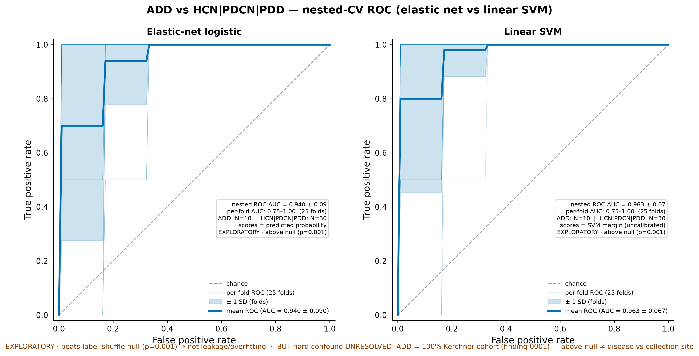
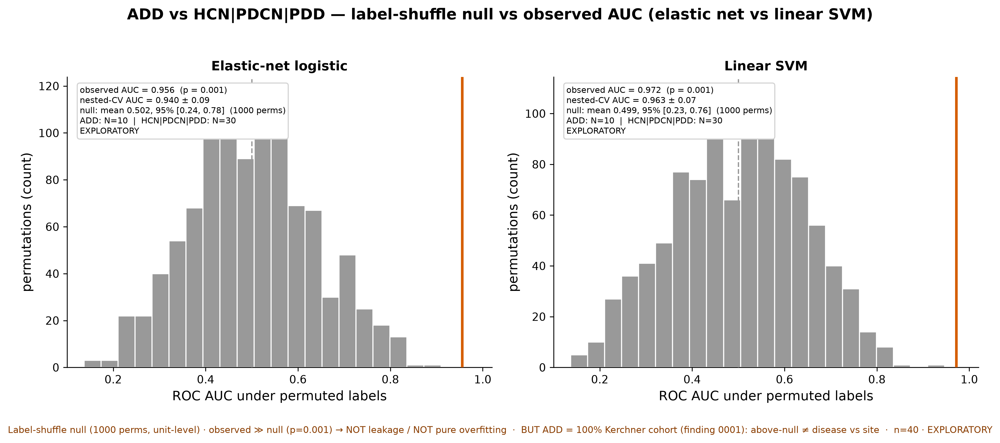
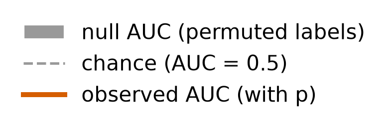
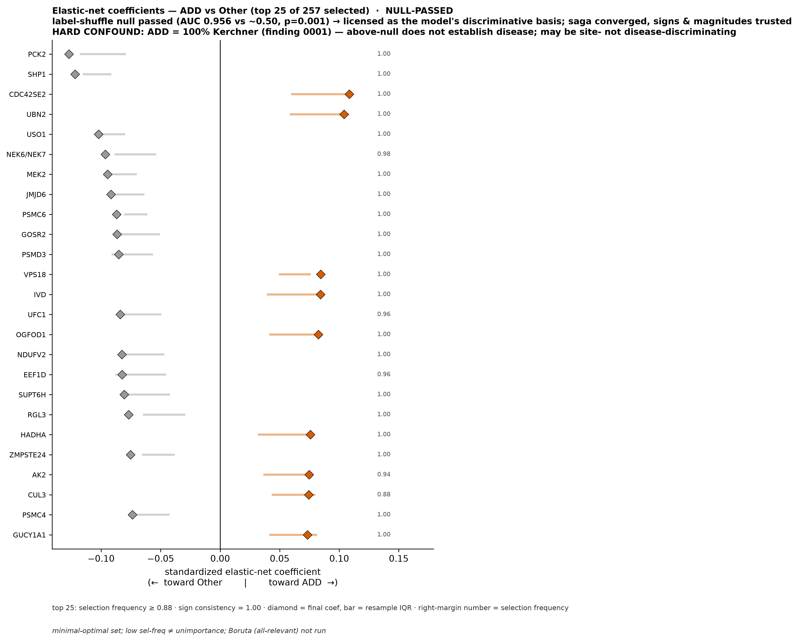
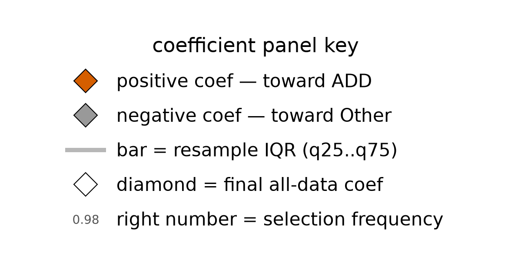
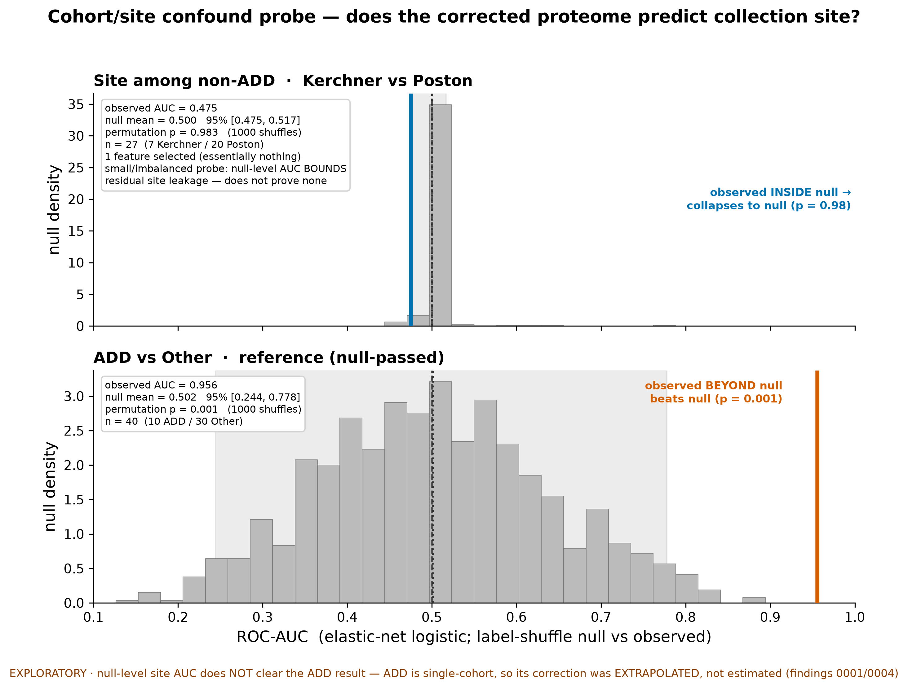
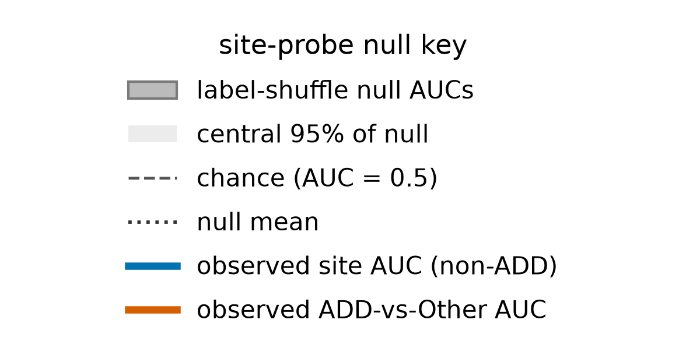

# The plasma-EV proteome predicts ADD-vs-others above chance (AUC ~0.96, beats label-shuffle null p=0.001) but the signal is confound-bounded — inseparable from collection site — and rides on intracellular proteins mostly reduced in ADD

## Summary
Two leakage-safe linear classifiers — an **elastic net** and a **linear SVM** — were trained to separate **ADD (n=10)** from a pooled **Other = {PDD, PDCN, HCN} (n=30)** group on the delivered 40×2340 log2 plasma-EV matrix, using stratified 5-fold × 5-repeat **nested** CV at the individual level (generalization target = unseen individuals, same cohort structure; seed 20260915). Both discriminate ADD well — nested ROC-AUC **0.940** (EN) and **0.963** (SVM) — and both **beat a 1000-permutation label-shuffle null** at empirical permutation **p=0.001**, which rules out leakage and pure overfitting. The catch is the design: **ADD is 100% Kerchner cohort** ([finding 0001](0001-group-aliased-with-cohort.md)), so among these 40 samples "ADD" and "Kerchner" are the same partition, and above-null discrimination **cannot** be attributed to disease vs collection site. The discriminative basis is predominantly **intracellular/organellar proteins mostly reduced in ADD** — not secreted EV-surface markers — and **23/25** of the top elastic-net features are also BH-q<0.05 DE hits ([finding 0006](0006-add-vs-other-differential-abundance.md)) with **100% direction agreement**.

## Verdict
There is a **genuine, reproducible, null-beating proteomic signal** distinguishing ADD from the other groups: leakage and overfitting are ruled out by the label-shuffle null. But this dataset **cannot determine whether the signal is ADD biology or the Kerchner collection site** — ADD and Kerchner are the same partition here, and the label-shuffle null does **not** resolve it because it permutes that same partition (it certifies *not-leakage / not-overfitting* only). The one test that could adjudicate — the cohort-site probe — is blocked: it collapses to null among the non-ADD samples, but because ADD is single-cohort its batch correction was **extrapolated, not estimated** ([finding 0004](0004-batch-correction-extrapolated-single-cohort.md)), so the probe **bounds** residual site leakage rather than clearing the ADD result. Coefficients are now **licensed** (null passed) and their **magnitudes trustworthy** (the elastic net converged), and they point at intracellular/organellar proteins mostly lower in ADD. This is **hypothesis-generating only**; confound-bounded is the ceiling on any disease interpretation. **Not promotable as-is:** the compute scripts are under `scripts/scratch/`, so this finding cannot be validated until they are code-reviewed and moved to `scripts/promoted/`.

## Evidence
Both classifiers separate ADD from pooled Other well and, critically, **beat a label-shuffle null**. The elastic net reaches nested ROC-AUC **0.940** (fold SD 0.09; observed fixed-hp 0.956; balanced acc 0.83, PR-AUC 0.87, MCC 0.63; 257 non-zero features; result `902c1e98c018`, converged at max_iter=20000). The linear SVM reaches **0.963** (observed 0.972; balanced acc 0.74, PR-AUC 0.92, MCC 0.52; C=0.001, 22 support vectors; result `a0e23fb510a0`). Under the 1000-permutation unit-level **label-shuffle null**, the EN null mean is 0.502 [0.244, 0.778] and the SVM null mean 0.500 [0.228, 0.756]; **both observed AUCs sit at empirical permutation p=0.001**. Leakage and pure overfitting are therefore ruled out — a real above-null signal separates ADD from Other. EN vs SVM is a **tie** (mean paired per-fold AUC difference 0.023, within seed noise; 21/25 folds identical; Wilcoxon p=0.068).

The standard performance view of this discrimination is the nested-CV ROC: both classifiers bow sharply toward the top-left, and the per-fold spread is the honest small-n uncertainty.

*Figure 1. Nested-CV ROC for the primary ADD-vs-Other classifiers (EN + SVM), from the current null-pass caches; ROC key on-axes (no separate legend image — the documented ROC exception). Produced by `scripts/figures/plot_roc_add_vs_other.py` (uncommitted) from data `protein-data.csv sha256:90a0462eb03a02bd`, results `902c1e98c018` (EN) + `a0e23fb510a0` (SVM).*

Both classifiers bow sharply toward the top-left — EN nested AUC 0.940±0.09, SVM 0.963±0.07 — while the per-fold curves fan out to AUC 0.75–1.00, the honest small-n uncertainty (10 ADD / 30 Other). This is the standard performance view of the discrimination whose reality is established by the permutation null (next figure) and whose interpretation is bounded by the cohort confound.

*Figure 2. Label-shuffle null vs observed AUC, both models. Produced by `scripts/figures/plot_roc_vs_null_add_vs_other.py` (uncommitted) from data `protein-data.csv sha256:90a0462eb03a02bd`, results `902c1e98c018` (EN) + `a0e23fb510a0` (SVM).*

The null mass piles up at 0.5 while both observed AUCs land far to the right at ~0.96 with p=0.001 — the picture of a signal that is real (not leakage, not overfitting), but which, because ADD=100% Kerchner, is above-null with respect to *some* ADD/Kerchner-aligned axis the null cannot tease apart from disease.

With the null passed, the elastic-net coefficients are **licensed** and, because the model converged, their **magnitudes are trustworthy**. The top 25 of 257 non-zero features are highly stable (selection frequency ≥0.88, sign consistency 1.00) and lean negative: **16 down / 9 up in ADD**. The leading features are PCK2(−), SHP1(−), CDC42SE2(+), UBN2(+), USO1(−), NEK6/7(−), MEK2(−), VPS18(+), IVD(+), NDUFV2(−).

*Figure 3. Top-25 elastic-net coefficients (null-pass). Produced by `scripts/figures/plot_en_coefficients_add_vs_other.py` (uncommitted) from data `protein-data.csv sha256:90a0462eb03a02bd`, result `902c1e98c018`.*

Read the bars: the discriminative basis is **predominantly proteins lower in ADD**, and by identity they are intracellular/organellar (mitochondrial, proteasome, kinases, vesicle-trafficking) rather than EV-surface cargo. This is a *selection*, not a per-feature significance test — there is no per-feature q, and the minimal-optimal caveat applies (a lower-ranked protein is not thereby unimportant; correlated features share credit). The convergence with the univariate contrast is strong: **23/25** of these top features are also BH-q<0.05 DE hits ([finding 0006](0006-add-vs-other-differential-abundance.md)), with **100%** coefficient-sign vs DE-log2FC direction agreement.

The cohort-site probe is the test that would adjudicate disease vs site — and its result must be read in **both directions, without overclaim**. Predicting **Kerchner (n=7) vs Poston (n=20)** among the 30 non-ADD samples **collapses to null**: ROC-AUC 0.34 (observed 0.475), null mean 0.500, permutation **p=0.983**, only 1 feature selected (result `b31f645d39ee`).

*Figure 4. Site probe vs the ADD signal. Produced by `scripts/figures/plot_site_probe_null.py` (uncommitted) from data `protein-data.csv sha256:90a0462eb03a02bd`, result `b31f645d39ee` (+ `902c1e98c018` as the ADD reference).*

The probe sits squarely in its null while the ADD signal sits far right of its own null. Read one way, the on-cohort limma `removeBatchEffect` **removed detectable within-non-ADD site structure** — site is not predictable among the non-ADD samples. Read honestly, this does **not** clear the ADD result: ADD is single-cohort, so its correction was **extrapolated not estimated** ([finding 0004](0004-batch-correction-extrapolated-single-cohort.md)), and the probe is small and imbalanced (n=27, 7 vs 20), so a null-level AUC **bounds** residual site leakage rather than proving none. The site probe cannot exonerate a confound in a stratum it does not contain.

## Methods / how to produce
Three scratch compute scripts drive this finding, all on the delivered analysis matrix `data/protein-data.csv` (`protein-data.csv sha256:90a0462eb03a02bd`, 40 samples × 2340 features), seed 20260915, from project copies of the `classification` / `classification-svm` templates:

- `scripts/scratch/classify_add_vs_other.py` — builds the binary factor **ADD vs Other = {PDD,PDCN,HCN} pooled** and runs the elastic-net and linear-SVM classifiers under stratified 5-fold×5-repeat nested CV (generalization target = unseen individuals), caching results `902c1e98c018` (EN) and `a0e23fb510a0` (SVM).
- `scripts/scratch/classify_add_vs_other_null.py` — runs the 1000-permutation unit-level **label-shuffle null** (null_repeats=3) for both models; both observed AUCs land at empirical p=0.001. This is the leakage check the univariate DE cannot provide.
- `scripts/scratch/classify_cohort_site_probe.py` — the **cohort-site probe**: restricts to the 30 non-ADD samples and predicts **Kerchner vs Poston** (class_weight=balanced), run against its own label-shuffle null; caches result `b31f645d39ee`.

Figures 1–3 are pure `load_cached_result → plot` jobs (`scripts/figures/plot_roc_vs_null_add_vs_other.py`, `plot_en_coefficients_add_vs_other.py`, `plot_site_probe_null.py`) over the named cached results — they recompute nothing. The environment is pinned by `uv.lock`; stochastic steps are seeded at 20260915. Result fingerprints, params, and the `run_null?`/status flags are registered in `results/manifest.md`.

**Not promotable as-is:** all three compute scripts are under `scripts/scratch/` (not code-reviewed, not promoted). This finding therefore **cannot be validated** until they are reviewed and moved to `scripts/promoted/` (`conventions/findings.md` §2.2, §4). The SVM result carries a residual **TuningNoiseWarning** (13/25 folds tune below the C plateau; AUC unchanged by the grid fix) that the stats-reviewer should assess.

## Discussion
The honest reading is a two-part one. First, the signal is **real in the not-leakage / not-overfitting sense** — the label-shuffle null settles that decisively, and it is what licenses the coefficients and makes their converged magnitudes trustworthy. Second, the signal is **confound-bounded**: ADD and the Kerchner collection site are one and the same partition among these 40 samples, so nothing in this dataset can tell disease biology apart from site. The cohort-site probe is the natural adjudicator and it collapses to null, but the collapse is *bounded evidence* — ADD's single-cohort correction is extrapolated, and the probe is small — so it lowers, without eliminating, the plausibility of residual site leakage. The discriminative proteins compound the caution: they are predominantly **intracellular/organellar** (mitochondrial PCK2/NDUFV2/IVD/HADHA, proteasome PSMC6/PSMD3/PSMC4, vesicle-trafficking USO1/VPS18/GOSR2, signalling MEK2/SHP1) and **mostly down in ADD** — not the secreted plasma/EV-surface markers a clean EV-biology story would predict. This is a **gene-name identity read**: a rigorous GO-CC over-representation test has **not** been run, and doing so is the honest next step (the intracellular/organellar interpretation here is a background claim that requires `references` and the enrichment test before promotion — see Caveats and the report flag).

## Caveats
- **Exploratory, small-n, imbalanced (relates_to [finding 0003](0003-contrasts-class-imbalanced-small-n.md)).** ADD 10 vs Other 30; the models were derived on the same data they are read on. The multiplicity context — this is the primary of several Stage-4 analyses explored — lives in `findings/exploration-log.md`. Never write this up with confirmatory confidence (`conventions/findings.md` §5).
- **The central limitation — collection-site confound (relates_to [finding 0001](0001-group-aliased-with-cohort.md)).** ADD is 100% Kerchner, so above-null discrimination **cannot** be attributed to disease vs site. The label-shuffle null does **not** resolve this — it permutes that same partition, so it establishes *not-leakage / not-overfitting only*. This is the ceiling on any disease interpretation.
- **The site probe bounds, it does not clear (relates_to [finding 0004](0004-batch-correction-extrapolated-single-cohort.md)).** The site-null in the non-ADD subset shows the on-cohort correction removed detectable within-non-ADD site structure, but ADD is single-cohort so its correction is **extrapolated not estimated**, and the probe is small/imbalanced (n=27, 7 vs 20). A null-level site AUC therefore bounds residual site leakage rather than proving none.
- **Selection, not per-feature significance.** The coefficient ranking is a stability read (selection frequency, sign consistency), not a per-feature test — there is no per-feature q. The **minimal-optimal** caveat applies: a low-ranked or unselected protein is not thereby unimportant (correlated features), and Boruta (all-relevant) was not run.
- **SVM tuning warning.** Result `a0e23fb510a0` carries a residual TuningNoiseWarning (13/25 folds tune below the C plateau); AUC is unchanged by the grid fix, but the stats-reviewer should confirm.
- **Intracellular-vs-EV reading is not yet enrichment-tested.** The organelle/compartment identity read rests on gene names; a GO-CC over-representation test has not been run, and the interpretive claim needs `references`.
- **Entity ids** cover only the named notable proteins; several top features (e.g. CDC42SE2, UBN2, JMJD6) are not yet normalized to verified accessions — the research-reviewer should complete and confirm the `entities` set at promotion.

## Follow-ups
- **Promote the compute scripts** (`classify_add_vs_other.py`, `classify_add_vs_other_null.py`, `classify_cohort_site_probe.py` → code review → `scripts/promoted/`) before any validation attempt.
- **Have the stats-reviewer assess the SVM TuningNoiseWarning** on result `a0e23fb510a0`.
- **Run a GO-CC (cellular-component) over-representation test** on the discriminative features to test the intracellular/organellar reading rigorously, and add fact-checked `references`.
- **Pursue blinded analytic replication** and, for any `confirmatory` claim, held-out / orthogonal data replication (none available in-project yet).
- **Complete and verify the `entities` set** (normalize the full top-25 to UniProt accessions; research-reviewer).
- If an ADD cohort from a *different* site ever becomes available, re-run the design that would actually break the ADD↔Kerchner alias — the only thing that can convert this from confound-bounded to disease-attributable.

## Related findings
- **relates_to → [finding 0001](0001-group-aliased-with-cohort.md):** diagnostic group is aliased with source cohort. ADD is 100% Kerchner, so above-null discrimination is inseparable from a collection-site effect — the hard ceiling on this finding.
- **relates_to → [finding 0004](0004-batch-correction-extrapolated-single-cohort.md):** the matrix is batch-corrected on cohort, and ADD's single-cohort correction is extrapolated not estimated — which is exactly why the site probe collapsing to null cannot clear the ADD result.
- **relates_to → [finding 0003](0003-contrasts-class-imbalanced-small-n.md):** class imbalance / small n (ADD 10 vs 30; site probe 7 vs 20), which is why the site-null bounds rather than proves absence of residual site leakage.
- **relates_to → [finding 0006](0006-add-vs-other-differential-abundance.md):** the univariate ADD-vs-Other DE result. 23/25 of the EN top-25 are also BH-q<0.05 DE hits with 100% direction agreement — the classifier and the contrast converge on the same intracellular, mostly-down-in-ADD basis.

## References
None yet — the intracellular/organellar-vs-secreted-EV-marker reading in the Discussion is a background/interpretive claim that requires `references` added and fact-checked by the research-reviewer, and a GO-CC enrichment test run, before promotion (see Caveats and Follow-ups).
</content>
