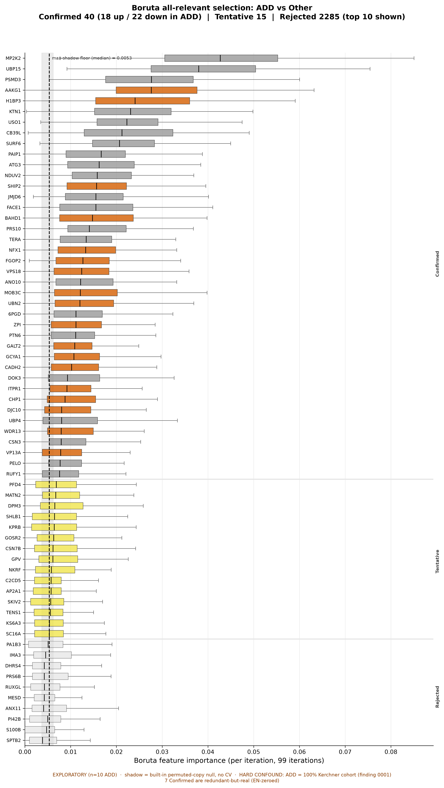
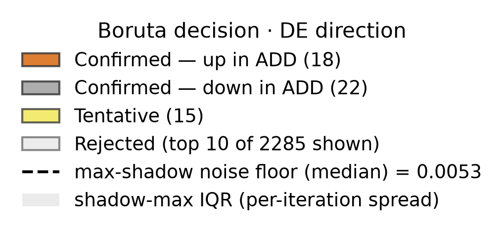

# Boruta all-relevant selection confirms 40 proteins (18 up / 22 down in ADD) for ADD-vs-others — 33 shared with the elastic-net minimal-optimal set plus 7 redundant-but-real proteins the classifier zeroed — still confound-bounded

## Summary
Boruta **all-relevant** feature selection — random-forest importance compared against **shadow (permuted-copy) features**, a built-in null — was run once on the full **40×2340 log2 experimental matrix** for the **ADD vs Other = {PDD, PDCN, HCN}** partition (default params: max_iter=100, alpha=0.05, perc=100; converged at 99 iterations; shadow-noise floor 0.0053; seed 20260915; result `762e16f294e3`). It confirms **40 proteins** as all-relevant (**40 Confirmed / 15 Tentative / 2285 Rejected**). By DE log2FC sign ([finding 0006](0006-add-vs-other-differential-abundance.md)) the signature is roughly balanced and bidirectional: **18 up / 22 down in ADD, 0 ambiguous**. Against the elastic-net **minimal-optimal** set (257 features, [finding 0007](0007-add-vs-other-classification-confound-bounded.md)), **33/40** Confirmed overlap and **7** are **redundant-but-real** — Boruta-confirmed but EN-zeroed (ANO10, ATG3, BAHD1, DOK3, NFX1, UBP4, VP13A) — correlated real signal the L1 penalty dropped for parsimony. **38/40** are also BH-q<0.05 DE hits, the two multivariate-only picks being NFX1 (q=0.054, up) and WDR13 (q=0.080, up).

## Verdict
This is the **all-relevant complement** to the classifier's minimal-optimal picture. Boruta's shadow null confirms that 40 proteins carry real (above-permuted-noise) signal for the ADD-vs-Other split, and it recovers **7 redundant-but-real proteins the elastic net zeroed** — the honest all-relevant vs minimal-optimal distinction. The signature is **balanced and bidirectional** (18 up / 22 down in ADD) and **38/40** corroborate the univariate DE hit list. But the ceiling is unchanged: the shadow null addresses **relevance-vs-noise, not the confound**. ADD is 100% Kerchner ([finding 0001](0001-group-aliased-with-cohort.md)), so "all-relevant to ADD" is all-relevant to the **ADD-vs-collection-site** partition, not necessarily to disease. **Exploratory** — n=10 positives, and the shadow null says nothing about sampling stability at this n ([finding 0003](0003-contrasts-class-imbalanced-small-n.md)). **Not promotable as-is:** the compute scripts are under `scripts/scratch/`, so this finding cannot be validated until they are code-reviewed and moved to `scripts/promoted/`. The Confirmed set reads predominantly intracellular/organellar **by gene name only** — a separate rigorous over-representation test found NO selective enrichment of that compartment (a follow-up finding will record it), so no enrichment claim is made here.

## Evidence
Boruta confirms **40 proteins** as all-relevant to the ADD-vs-Other partition (**40 Confirmed / 15 Tentative / 2285 Rejected**), each Confirmed feature's random-forest importance exceeding the permuted-copy **shadow-noise floor of 0.0053**; the run converged at 99 of 100 iterations (result `762e16f294e3`, seed 20260915). This is a *selection*, not a per-feature significance test — there is no per-feature q. By DE log2FC sign the Confirmed set is **18 up / 22 down in ADD, 0 ambiguous** — a roughly balanced, bidirectional signature. Against the elastic-net minimal-optimal set (257 non-zero features, [finding 0007](0007-add-vs-other-classification-confound-bounded.md)), **33/40** overlap and **7** are **redundant-but-real** — Boruta-confirmed but EN-zeroed (ANO10, ATG3, BAHD1, DOK3, NFX1, UBP4, VP13A). Against the univariate contrast, **38/40** are also BH-q<0.05 DE hits ([finding 0006](0006-add-vs-other-differential-abundance.md)); the two multivariate-only picks are NFX1 (q=0.054, up) and WDR13 (q=0.080, up).

The all-relevant selection is shown as the per-iteration importance distribution against the shadow floor:

*Figure 1. Boruta all-relevant importances for ADD vs pooled Other. Produced by `scripts/figures/plot_boruta_importance_add_vs_other.py` (uncommitted) from data `protein-data.csv sha256:90a0462eb03a02bd`, result `762e16f294e3`.*

Read the blocks left to right: every **Confirmed** box sits to the right of the shadow-noise floor — all 40 cleared the permuted-copy shadows, which is what "all-relevant" means here — while the **Rejected** mass sits at or below it. The Confirmed features split roughly evenly by color into up- and down-in-ADD (18 vs 22), a balanced bidirectional signature rather than a one-directional shift. Because the shadow null only distinguishes real signal from permuted noise, this figure establishes *relevance*, not disease-specificity: the same 40 proteins are all-relevant to the ADD-vs-Kerchner-site partition that ADD is aliased with, so the picture is **confound-bounded**.

## Methods / how to produce
Two scratch scripts drive the selection, both on the delivered analysis matrix `data/protein-data.csv` (`protein-data.csv sha256:90a0462eb03a02bd`, 40 samples × 2340 features), seed 20260915, adapted from the `boruta` template:

- `scripts/scratch/boruta_add_vs_other.py` — binarizes **ADD=1 vs {PDD,PDCN,HCN}=0** and runs Boruta all-relevant selection (random-forest estimator, `class_weight=balanced`; max_iter=100, alpha=0.05, perc=100, two-step correction), caching result `762e16f294e3` (40 Confirmed / 15 Tentative / 2285 Rejected; shadow floor 0.0053).
- `scripts/scratch/boruta_selection.py` — post-processes the cached decision into the Confirmed/Tentative/Rejected sets, cross-references the elastic-net non-zero set (result `902c1e98c018`, [finding 0007](0007-add-vs-other-classification-confound-bounded.md)) and the DE hits ([finding 0006](0006-add-vs-other-differential-abundance.md)) to produce the 33/40 overlap, the 7 redundant-but-real EN-zeroed proteins, the 38/40 DE overlap, and the 18-up/22-down direction split.

Boruta all-relevant selection runs **once on the whole matrix (no CV)** — feeding it the ComBat/limma batch-corrected matrix is legitimate for *selection* (there is no held-out generalization estimate to leak into). Figure 1 is a pure `load_cached_result → plot` job (`scripts/figures/plot_boruta_importance_add_vs_other.py`) over result `762e16f294e3` — it recomputes nothing. The environment is pinned by `uv.lock` (this run added `boruta>=0.4.3`); the stochastic RF/shadow steps are seeded at 20260915. The fingerprint, params, and `run_null?`/status flags are registered in `results/manifest.md`.

**Not promotable as-is:** both compute scripts are under `scripts/scratch/` (not code-reviewed, not promoted). This finding therefore **cannot be validated** until they are reviewed and moved to `scripts/promoted/` (`conventions/findings.md` §2.2, §4).

## Discussion
The value of the all-relevant view is that it names signal the minimal-optimal classifier deliberately discards. The elastic net's L1 penalty keeps a *parsimonious* subset and zeros correlated redundancies; Boruta, by testing every feature against permuted copies, recovers those redundancies as **redundant-but-real** — here the 7 EN-zeroed proteins (ANO10, ATG3, BAHD1, DOK3, NFX1, UBP4, VP13A). That a feature was zeroed by the classifier is therefore **not** evidence it is noise; it may be correlated-but-real, and Boruta is the test that tells the two apart. The strong convergence with the univariate contrast (38/40 also DE hits) and the balanced bidirectional split (18 up / 22 down) both reinforce that this is a coherent multivariate signature, not an artifact of one estimator's inductive bias.

The Confirmed set reads **predominantly intracellular/organellar by gene name** (proteasome, mitochondrial, ER/Golgi, autophagy/endo-lysosomal, nuclear), with the one notable secreted exception being SERPINA10/ZPI — the same qualitative pattern seen in the classifier and DE findings. This is a **gene-name impression, not an enrichment result**: a rigorous over-representation test of that compartment impression was run separately and found **no selective over-representation**, and it will be recorded as its own follow-up finding. No compartment-enrichment claim is asserted here.

## Caveats
- **The ceiling — collection-site confound (relates_to [finding 0001](0001-group-aliased-with-cohort.md)).** ADD is 100% Kerchner, so "all-relevant to ADD" is all-relevant to the ADD-vs-collection-site partition — not necessarily to disease. The Boruta shadow null addresses **relevance-vs-noise**, not the confound; it cannot separate disease biology from site.
- **Exploratory, small-n (relates_to [finding 0003](0003-contrasts-class-imbalanced-small-n.md)).** n=10 positives. The shadow null distinguishes real signal from permuted noise but says nothing about **sampling stability** at this n — a different Confirmed set could emerge on a resample. Never write this up with confirmatory confidence (`conventions/findings.md` §5). The multiplicity context (this is one of several Stage-4 analyses) lives in `findings/exploration-log.md`.
- **Selection, not per-feature significance.** There is no per-feature q. The **minimal-optimal** caveat is complemented, not removed: Boruta answers "all-relevant vs noise", the elastic net answers "minimal sufficient subset" — different questions with different membership.
- **Compartment read is not enrichment.** The predominantly intracellular/organellar impression is by gene name only; a rigorous over-representation test found no selective enrichment (a follow-up finding will record it), so no enrichment is claimed here.
- **Entities not yet normalized.** The notable named proteins (the 7 EN-zeroed, NFX1, WDR13, SERPINA10/ZPI) are not yet mapped to verified UniProt accessions; the research-reviewer should complete and verify the full Confirmed-40 `entities` set at promotion.

## Follow-ups
- **Promote the compute scripts** (`boruta_add_vs_other.py`, `boruta_selection.py` → code review → `scripts/promoted/`) before any validation attempt.
- **Record the compartment over-representation follow-up finding** (the rigorous test that found NO selective enrichment of the intracellular/organellar compartment), and link it here.
- **Normalize and verify the `entities` set** — map the full 40 Confirmed proteins (and the 7 redundant-but-real + NFX1/WDR13/SERPINA10) to verified UniProt accessions (research-reviewer).
- **Pursue blinded analytic replication** once scripts are promoted; and, for any `confirmatory` claim, held-out / orthogonal data replication (none available in-project yet).
- If an ADD cohort from a *different* site ever becomes available, re-run the design that breaks the ADD↔Kerchner alias — the only thing that can convert all-relevance-to-ADD into all-relevance-to-disease.

## Related findings
- **relates_to → [finding 0001](0001-group-aliased-with-cohort.md):** diagnostic group is aliased with source cohort. ADD is 100% Kerchner, so features "all-relevant to ADD" are all-relevant to the ADD-vs-collection-site partition — the shadow null cannot separate disease from site. The hard ceiling.
- **relates_to → [finding 0007](0007-add-vs-other-classification-confound-bounded.md):** the elastic-net / SVM classifier. This finding is its all-relevant complement — 33/40 Confirmed lie in the EN minimal-optimal 257-feature set, and 7 (ANO10, ATG3, BAHD1, DOK3, NFX1, UBP4, VP13A) are redundant-but-real correlated signal the L1 penalty zeroed.
- **relates_to → [finding 0006](0006-add-vs-other-differential-abundance.md):** the univariate ADD-vs-Other DE result. 38/40 Confirmed are BH-q<0.05 DE hits; the 2 multivariate-only picks are NFX1 (q=0.054, up) and WDR13 (q=0.080, up); the 18-up/22-down direction split is read from the DE log2FC signs.
- **relates_to → [finding 0003](0003-contrasts-class-imbalanced-small-n.md):** class imbalance / small n (10 ADD positives). The shadow null addresses relevance-vs-noise, not sampling stability at this n — which is why this finding stays exploratory.

## References
None. The "predominantly intracellular/organellar" reading is a gene-name impression, not an enrichment assertion — a rigorous over-representation test found no selective over-representation (to be recorded as a follow-up finding), so no background/interpretive claim requiring a reference is made here.
</content>
</invoke>
