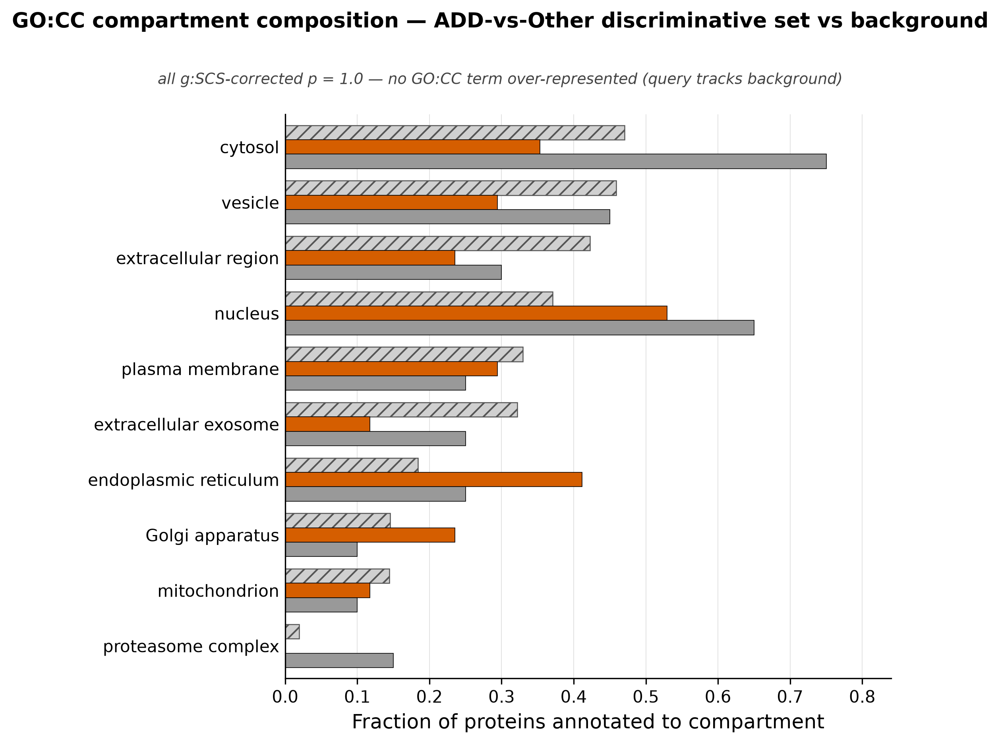
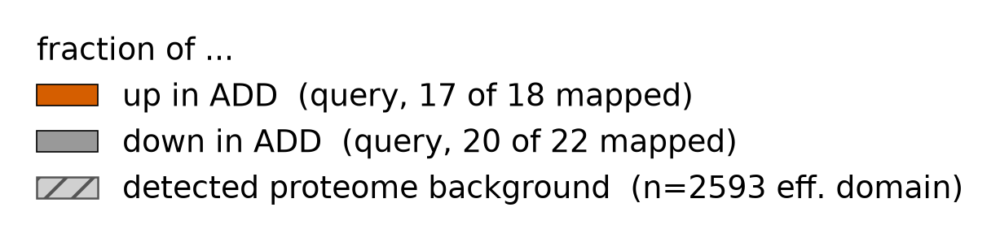

# No GO or KEGG count-based over-representation (ORA) in the ADD-vs-others discriminative hit-set (all four sources, both directions) — the 'intracellular' impression reflects plasma-EV proteome SET composition; abundance-weighted (GSEA) pathway enrichment was NOT tested and remains possible

> **Scope of this finding (read first).** This is an **over-representation analysis (ORA)** — it asks only whether the **discrete, thresholded** 40-protein hit-set is **count-enriched** for any term relative to the detected-proteome background. ORA is **count/membership-based and unweighted**: it ignores each protein's effect size and abundance. The null result below therefore means **only** that this small discrete hit-set is not count-enriched for any term. It does **not** establish that "no pathway is involved." A **coordinated, abundance/effect-weighted** pathway shift — the kind a **rank-based GSEA** would detect over all 2340 proteins ranked by ADD-vs-Other effect — **was not tested and remains possible** (see Caveats and Follow-ups).

## Summary
A g:Profiler over-representation analysis (ORA) of the Boruta all-relevant **Confirmed set** ([finding 0008](0008-boruta-all-relevant-add-vs-other.md)) — 40 proteins, split by DE log2FC direction into **18 up-in-ADD** and **22 down-in-ADD**, enriched **separately** against the **detected plasma-EV proteome background** (2340 proteins; g:Profiler effective domain 2593 genes) with the g:Profiler default **g:SCS** correction — finds **NO significant term in either direction across all four sources tested: GO:BP, GO:CC, GO:MF, and KEGG.** Every g:SCS-corrected p is exactly **1.0** (not merely >0.05). Up query: 1209 terms tested (BP 783 / CC 172 / MF 178 / KEGG 76), 0 significant. Down query: 1419 terms tested (BP 992 / CC 150 / MF 177 / KEGG 100), 0 significant. So there is **no count-based over-representation of any process, function, compartment, or pathway** in the discrete discriminative hit-set. This is a statement about **count-enrichment of the thresholded set only** — an **abundance/effect-weighted** (GSEA) pathway shift was not tested and is not ruled out (see Scope above, Caveats, and Follow-ups).

## Verdict
Scoped precisely: the **discrete discriminative hit-set is not count-over-represented** for any GO/KEGG term. The "intracellular signature" impression carried in the DE ([finding 0006](0006-add-vs-other-differential-abundance.md)), classifier ([finding 0007](0007-add-vs-other-classification-confound-bounded.md)), and Boruta ([finding 0008](0008-boruta-all-relevant-add-vs-other.md)) findings is a **set-composition artifact — the discriminative SET is not more intracellular than the plasma-EV proteome it was drawn from.** The down-in-ADD proteins *are* individually intracellular/organellar — proteasome complex (3/20), ER, cytosol, intracellular vesicle, autophagy/ATG3, mitochondrial complex-I NDUFV2 — but they are **not count-over-represented**, because the plasma-EV background is *itself* intracellular + exosomal. The query's compartment composition **mirrors** the background. Nominal fractional deviations exist (down-proteasome 15% vs 1.9% background; up-ER 41% vs 18%) but are small-count (17-20-protein queries, ≈5-6% per protein) and **do not survive g:SCS**. This is a negative/null **ORA** result that doubles as a corrective caveat on the sibling findings.

**What this does NOT say.** ORA is count/membership-based and **unweighted** — it ignores effect size and abundance and, at 18/22 proteins, is underpowered. So this null means only that the small discrete hit-set is not count-enriched. It does **not** establish that "no pathway is involved" or that ADD is "not a specific pathway program." A **coordinated, abundance/effect-weighted** pathway shift — the kind a **rank-based GSEA** would detect by ranking all 2340 proteins by their ADD-vs-Other effect and testing whether a pathway's members are coordinately shifted — **was not tested and remains possible.** GSEA can find coordinated pathway signal where ORA is null, precisely because it uses every protein weighted by magnitude rather than a thresholded count.

**Exploratory and underpowered** — 18/22-protein queries are low-power, so absence of count-enrichment is partly a power statement (absence of enrichment ≠ evidence of absence). **Confound-bounded** — even had terms survived, ORA characterizes *what* the discriminative set is, not disease-vs-site ([finding 0001](0001-group-aliased-with-cohort.md)). **Not promotable as-is** — the compute scripts are under `scripts/scratch/`.

## Evidence
The core result is a comprehensive null. Splitting the 40 Boruta-Confirmed proteins by DE direction and enriching each set separately against the detected-proteome background, **no term is significant in either direction across any of the four sources**, with every g:SCS-corrected p equal to 1.0:

- **Up-in-ADD (18 proteins):** 0 significant of **1209** terms tested — GO:BP 783, GO:CC 172, GO:MF 178, KEGG 76.
- **Down-in-ADD (22 proteins):** 0 significant of **1419** terms tested — GO:BP 992, GO:CC 150, GO:MF 177, KEGG 100.

This is *term-level* enrichment evidence (a corrected p per term, no per-feature q); here the corrected p is 1.0 for every tested term. The down-in-ADD proteins are individually intracellular/organellar (proteasome complex 3/20, ER, cytosol, intracellular vesicle, autophagy/ATG3, mito complex-I NDUFV2), but none of those compartments is over-represented against the background.

The reason is visible in the GO:CC compartment composition — the query fractions sit inside the background's range across compartments:

*Figure 1. GO:CC compartment composition of the ADD-vs-Other discriminative set vs the detected-proteome background. Produced by `scripts/figures/plot_gocc_composition_add_vs_other.py` (uncommitted) from `results/enrichment/add-vs-other-boruta-confirmed/{up,down}_in_ADD_terms.csv`, data `protein-data.csv sha256:90a0462eb03a02bd`. This panel shows GO:CC only; the null result covers all four sources tested (GO:BP, GO:MF, GO:CC, KEGG).*

Read the three series across compartments: the query fractions stay within the background's range compartment by compartment — the discriminative set's compartment profile *is* the background's profile. Where the query does deviate nominally (down cytosol/proteasome running high, up ER running high) the excess is a handful of proteins in a 17-20-protein query (≈5-6% per protein), and none of it survives g:SCS. That is why the intracellular/organellar character read off gene names in [findings 0006](0006-add-vs-other-differential-abundance.md), [0007](0007-add-vs-other-classification-confound-bounded.md), and [0008](0008-boruta-all-relevant-add-vs-other.md) is, **at the level of set composition, inherited from the plasma-EV proteome** rather than being a compartment the discriminative set is count-over-represented for. (This is a statement about the composition of the discrete set only — it does not speak to whether a coordinated, abundance-weighted pathway shift exists; that would require the rank-based GSEA noted in Caveats and Follow-ups.)

## Methods / how to produce
The query is the Boruta all-relevant Confirmed set (result `762e16f294e3`, [finding 0008](0008-boruta-all-relevant-add-vs-other.md)), split into 18 up-in-ADD and 22 down-in-ADD by the sign of the DE log2FC (ADD minus Other; `results/differential_abundance/add-vs-other-moderated/contrast_table.csv`, [finding 0006](0006-add-vs-other-differential-abundance.md); ambiguous if |log2FC| < 0.1, of which there were none). Two scratch scripts drive it:

- `scripts/scratch/enrich_add_vs_other_boruta.py` — assembles the up/down query sets and the detected-proteome background, decodes ids, and calls the enrichment routine.
- `scripts/scratch/enrichment.py` — the g:Profiler ORA wrapper (adapted from the `enrichment` lib template, v0.1).

Each query is enriched **separately** against the **detected plasma-EV proteome background** (2340 proteins; g:Profiler effective domain 2593 genes), organism `hsapiens`, sources GO:BP / GO:CC / GO:MF / KEGG, correction **g:SCS** (g:Profiler default), threshold 0.05. The g:Profiler service version is **e114_eg62_p19_27110d83** — a versioned live service, recorded as the reproducibility anchor. The ID decode is **100% clean**: 40/40 query proteins and 2340/2340 background proteins mapped (`decode_audit.csv`). The query is deterministic — **no seed** is involved. Result tables and provenance: `results/enrichment/add-vs-other-boruta-confirmed/` (`up_in_ADD_terms.csv`, `down_in_ADD_terms.csv`, `decode_audit.csv`, `enrichment_provenance.json`). Figure 1 renders the term tables (`scripts/figures/plot_gocc_composition_add_vs_other.py`) and recomputes no enrichment.

**Not promotable as-is:** both compute scripts are under `scripts/scratch/` (not code-reviewed, not promoted), so this finding cannot be validated until they are reviewed and moved to `scripts/promoted/` (`conventions/findings.md` §2.2, §4).

## Discussion
The scientific value of this negative result is that it disarms one specific over-reading — an over-reading *of the discrete hit-set*. Reading gene names off a discriminative list ("proteasome, ER, mitochondria, autophagy — this is intracellular") is intuitive but not a test: it ignores what the *background* looks like. A plasma extracellular-vesicle proteome is dominated by exosomal cargo, which is heavily intracellular/organellar in origin. A discriminative subset drawn from that proteome therefore *starts* intracellular — so a proper ORA asks the only honest count-based question: is the subset **more** intracellular than the pool it was drawn from? Against the detected-proteome background, the answer is no — the query's **set composition** mirrors the background, every corrected p is 1.0, and no process, function, compartment, or pathway is **count-over-represented** in either direction. The correct statement about [findings 0006](0006-add-vs-other-differential-abundance.md)/[0007](0007-add-vs-other-classification-confound-bounded.md)/[0008](0008-boruta-all-relevant-add-vs-other.md) is thus scoped to composition: the discriminative proteins are intracellular *because the plasma-EV proteome is*, and the discriminative SET is **not more** intracellular than that proteome.

**What this analysis cannot conclude — and why GSEA is a different question.** This is over-representation analysis: it thresholds the data into a discrete 40-protein hit-set and tests **membership counts** against the background, unweighted by effect size or abundance. That is a deliberately narrow question, and an underpowered one at 18/22 proteins. It is therefore **not** a licence to say "ADD is not a pathway program" or "no pathway biology is involved." Those are claims about **coordinated, magnitude-weighted** pathway behavior, and the right instrument for them is a **rank-based GSEA**: rank all 2340 detected proteins by their ADD-vs-Other effect and ask whether a pathway's members are **coordinately shifted** toward one end of the ranking. GSEA routinely detects coordinated pathway signal where ORA is null — a pathway whose members are *each* modestly shifted (below any hit-set threshold) can be strongly coordinated in the ranking while contributing zero over-representation to a thresholded count. **That test was not run** (at the scientist's direction; see Follow-ups). So the honest scope of this finding is: **no count-based over-representation of the discriminative set**; abundance/effect-weighted, coordinated pathway enrichment is **untested and not ruled out**. *(Scoping limitation raised by the scientist.)*

## Caveats
- **ORA vs GSEA — the scope limit on this finding (raised by the scientist).** This run is **over-representation analysis (ORA, g:Profiler)**: it tests whether the **discrete, thresholded** set of discriminative proteins (the 40 Boruta-Confirmed, split 18/22) contains **more members** of a GO/KEGG term than expected **by count**, relative to the detected-proteome background. ORA is **count/membership-based and unweighted** — it ignores each protein's effect size and abundance, and with only 18/22 proteins it is underpowered. Therefore the ORA null (all g:SCS p=1.0, all four sources, both directions) means **only** that this small discrete hit-set is not count-enriched for any term. It **does not** establish that "no pathway is involved" or that ADD is "not a specific pathway program." A **coordinated, abundance/effect-weighted** pathway shift — the kind a **rank-based GSEA (Gene Set Enrichment Analysis)** would detect by ranking **all 2340** proteins by their ADD-vs-Other effect and testing whether a pathway's members are coordinately shifted — was **not tested and remains possible**. GSEA can find coordinated pathway signal precisely where ORA is null, because it uses every protein weighted by magnitude rather than a thresholded count. **Read this finding's scope as: no count-based over-representation of the discriminative SET — NOT as ruling out abundance-weighted / coordinated pathway enrichment.**
- **Underpowered / small-n (relates_to [finding 0003](0003-contrasts-class-imbalanced-small-n.md)).** The queries are small (18 up, 22 down); few terms could survive g:SCS at this size regardless of biology. So this null is **partly a power statement** — absence of enrichment is **not** evidence of absence of enrichment. A larger, unconfounded discriminative set could yet show real enrichment.
- **Confound ceiling (relates_to [finding 0001](0001-group-aliased-with-cohort.md)).** Even had terms survived, ORA characterizes *what* the discriminative set is (compartment/process/pathway) — it does **not** speak to disease-vs-site. The Confirmed set is all-relevant to the ADD-vs-Kerchner-site partition ADD is aliased with, so any enrichment would describe the set, not resolve disease from collection site.
- **Nominal deviations are not significant.** Down-proteasome (15% vs 1.9% background) and up-ER (41% vs 18%) look large but are small-count fluctuations (≈5-6% per protein in 17-20-protein queries) and do not survive g:SCS. They are shown in Figure 1 to make the composition-vs-enrichment point, not asserted as effects.
- **Live-service anchor.** g:Profiler is a versioned live service; the version (e114_eg62_p19_27110d83) and the custom background are pinned so the ORA is reproducible, but a re-run against a later g:Profiler release could differ.
- **Multiplicity context.** This is one of several Stage-4 analyses following the ADD-vs-Other line; the full set of what was tried and discarded is in `findings/exploration-log.md`.

## Follow-ups
- **Run a rank-based GSEA if abundance-weighted pathway enrichment is of interest (not yet run, at the scientist's direction).** This ORA tested only count-over-representation of the discrete hit-set. The appropriate next test for *coordinated* pathway biology is a **rank-based GSEA** over the **full effect-ranked proteome** — rank all 2340 detected proteins by their ADD-vs-Other effect (e.g. signed DE statistic / log2FC from [finding 0006](0006-add-vs-other-differential-abundance.md)) and test whether each GO/KEGG term's members are coordinately shifted. GSEA can reveal coordinated pathway enrichment that ORA misses because it weights every protein by magnitude rather than thresholding a count. This would still be confound-bounded (relates_to [finding 0001](0001-group-aliased-with-cohort.md)) and exploratory, but it is the missing complement to the present null.
- **Record the entities set once.** Normalize + label the 40 Confirmed proteins (verified accessions already in the result provenance) shared across [0006](0006-add-vs-other-differential-abundance.md)/[0007](0007-add-vs-other-classification-confound-bounded.md)/[0008](0008-boruta-all-relevant-add-vs-other.md)/[0009](0009-no-go-kegg-enrichment-add-vs-other.md) (research-reviewer).
- **Promote the compute scripts** (`enrich_add_vs_other_boruta.py`, `enrichment.py` → code review → `scripts/promoted/`) before any validation attempt.
- **Attach a reference** for the plasma-EV proteome's intracellular/exosomal composition claim in ## Discussion, or confine that claim to what Figure 1 shows (research-reviewer).
- If an unconfounded, larger ADD discriminative set ever becomes available (a different-site ADD cohort), re-run the ORA — the power and confound limits are the only reasons this result is not decisive.

## Related findings
- **relates_to → [finding 0008](0008-boruta-all-relevant-add-vs-other.md):** the query IS the Boruta all-relevant Confirmed set (40 proteins, 18 up / 22 down). This is the enrichment follow-up 0008 named as outstanding — it rigorously tests, and rejects, the intracellular/organellar compartment impression 0008 recorded as a gene-name read only.
- **relates_to → [finding 0006](0006-add-vs-other-differential-abundance.md):** QUALIFIES/corrects its "dominated by intracellular proteins" observation — a gene-name read; rigorously there is no selective enrichment, the query composition mirrors the plasma-EV background.
- **relates_to → [finding 0007](0007-add-vs-other-classification-confound-bounded.md):** QUALIFIES/corrects its "rides on intracellular proteins mostly reduced in ADD" observation — those proteins are individually intracellular but not over-represented against the intracellular+exosomal background.
- **relates_to → [finding 0001](0001-group-aliased-with-cohort.md):** the confound ceiling — ORA characterizes what the discriminative set is, not disease-vs-site; the set is all-relevant to the ADD-vs-Kerchner-site partition.
- **relates_to → [finding 0003](0003-contrasts-class-imbalanced-small-n.md):** small-n — the 18/22-protein queries are underpowered, so a null ORA is partly a power statement (absence of enrichment ≠ evidence of absence).

## References
None asserted yet. The interpretive claim that the plasma-EV proteome is itself intracellular + exosomal (so a query drawn from it mirrors it) currently rests on the data (Figure 1 — query composition vs the detected-proteome background). If the finding matures, the research-reviewer should attach a reference for the plasma-EV exosomal/intracellular proteome composition, or the statement should be confined to what the data shows. The g:Profiler software/version (e114_eg62_p19_27110d83) is recorded in `provenance`.
</content>
</invoke>
