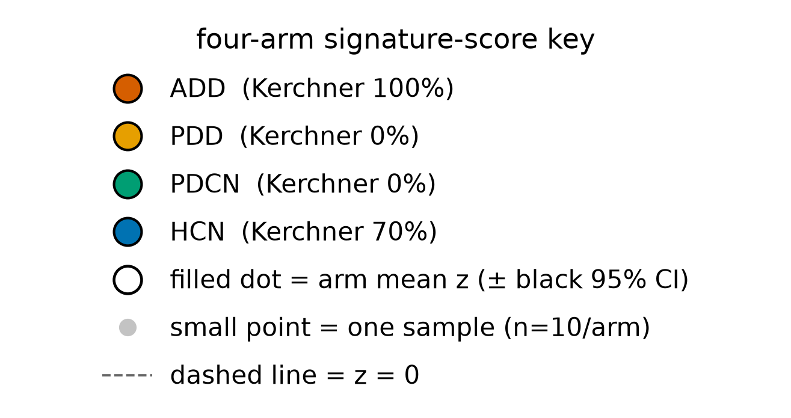
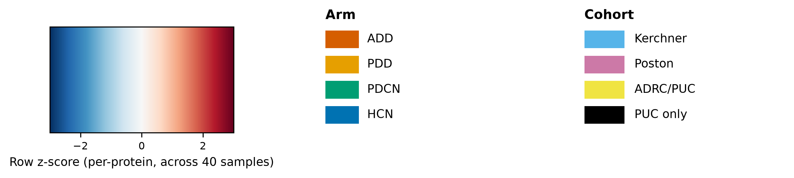

# ADD-vs-Other signature is ADD-specific across the four arms — PDD (dementia control) does not share it — but the specificity is confound-bounded (aliased with the Kerchner collection site)

## Summary
The Boruta-confirmed **40-protein ADD-vs-Other signature** (18 up / 22 down in ADD; [finding 0006](0006-add-vs-other-differential-abundance.md), [finding 0008](0008-boruta-all-relevant-add-vs-other.md)), profiled across the four design arms as **per-sample summary z-scores**, is **ADD-specific**. The **down-in-ADD set** drops **only in ADD** (mean z **−1.06** [95% CI −1.30,−0.83]) while **PDD — the dementia control — sits at +0.47** [0.31,0.63], essentially identical to non-demented **PDCN +0.55** [0.34,0.76], with **HCN near baseline +0.04** [−0.21,0.30]. The **up-in-ADD set** mirrors this (ADD +0.96 [0.68,1.24]; PDD −0.48; PDCN −0.51; HCN +0.03). All **six** ADD-vs-arm comparisons are large and BH-significant (Hedges g 2.17–5.20). A **dementia-vs-dementia ADD-vs-PDD** moderated (eBayes) contrast returns **207 hits at BH q<0.05** (354 at q<0.10), with 35/40 of the Boruta-40 significant and 40/40 direction-concordant — but that contrast is a **near-pure Kerchner-vs-Poston cross-cohort** comparison.

## Verdict
Within the four-arm structure the signature behaves as **ADD-specific** — not dementia-generic (PDD looks like PDCN, not ADD) and not PD-generic. This is the design's intended discriminating test, and it favors an ADD-linked pattern over a generic-dementia one. **BUT it is confound-bounded:** the arm profile tracks the Kerchner-vs-Poston axis almost exactly (ADD 100% Kerchner; PDD/PDCN 0%; HCN 70%), so "ADD-specific" is observationally identical to "Kerchner-site-specific" and is **not identifiable in this design** ([finding 0001](0001-group-aliased-with-cohort.md), [finding 0004](0004-batch-correction-extrapolated-single-cohort.md)). One genuine within-design mitigant, stated but not over-read: **HCN is 70% Kerchner yet sits at baseline** (up +0.03, down +0.04), which a pure site fingerprint would not predict — mildly favoring a real ADD/disease component, though HCN still differs from ADD by disease and by **collection year** ([finding 0002](0002-collection-year-skews-across-groups.md)), so this weakens without removing the confound. The **ADD-vs-PDD contrast cannot adjudicate**: ADD is 100% Kerchner and PDD ~70% Poston, so it conflates disease with collection site even more than the pooled contrast, and its p/q are anticonservative on the batch-corrected matrix ([finding 0004](0004-batch-correction-extrapolated-single-cohort.md)). **Exploratory, n=10/arm** ([finding 0003](0003-contrasts-class-imbalanced-small-n.md)). **Not promotable as-is** — the compute script is under `scripts/scratch/` (not code-reviewed/promoted), so this finding cannot be validated until it is reviewed and moved to `scripts/promoted/`.

## Evidence
Profiling the two signature sets across the four arms gives the central result. The **down-in-ADD set (22 proteins)** drops only in ADD — ADD **−1.06** [−1.30,−0.83] — while the dementia control **PDD sits at +0.47** [0.31,0.63], essentially the same as non-demented **PDCN +0.55** [0.34,0.76], and **HCN is at baseline +0.04** [−0.21,0.30] (n=10/arm). The **up-in-ADD set (18 proteins)** mirrors it exactly: ADD **+0.96** [0.68,1.24], PDD −0.48 [−0.55,−0.41], PDCN −0.51 [−0.68,−0.35], HCN +0.03 [−0.27,0.34]. The ADD-vs-arm separations are all large and BH-significant over the 6-comparison family (down-set Hedges g: ADD-vs-PDD −5.20 [−7.11,−3.29] q=5.0e-9, ADD-vs-PDCN −5.00 [−6.85,−3.14] q=5.0e-9, ADD-vs-HCN −3.10 [−4.43,−1.76] q=1.3e-6; up-set: ADD-vs-PDD +4.84 [3.03,6.64] q=6.9e-7, ADD-vs-PDCN +4.40 [2.72,6.09] q=9.5e-8, ADD-vs-HCN +2.17 [1.04,3.29] q=8.3e-5). Because the up/down split is *defined* by ADD-vs-Other, ADD is extreme by construction — the **non-circular** comparison is **among PDD/PDCN/HCN**, where **PDD ≈ PDCN ≠ ADD** is the real result.

The per-arm summary-score profile shows the ADD-specific pattern directly:

*Figure 1. Per-arm summary z-scores of the up/down ADD-vs-Other signature sets across the four arms. Produced by `scripts/figures/plot_four_arm_signature_scores.py` (uncommitted) from `results/four_arm/8d418bb8509f/{sample_scores,per_arm_scores,arm_comparisons}.parquet`, data `protein-data.csv sha256:90a0462eb03a02bd`, result `8d418bb8509f`.*

Read the two series across the arms: the down-set (and its mirror, the up-set) moves sharply only at ADD, while PDD and PDCN land together on the opposite side and HCN sits near zero. That PDD tracks PDCN rather than ADD is the discriminating read — the signature is **not dementia-generic**. But the Kerchner-fraction annotation beneath each arm rises and falls with the same profile, which is exactly why the specificity is confound-bounded (see below).

The full-matrix heatmap makes both the coherent ADD block and its aliasing with cohort visible at the sample level:

*Figure 2. Boruta-40 abundance heatmap across all 40 samples, blocked by arm. Produced by `scripts/figures/plot_boruta40_arm_heatmap_add_specificity.py` (uncommitted) from the loader (`scripts/scratch/project_loader.py`) + `results/four_arm/8d418bb8509f/signature_direction.parquet`, data `protein-data.csv sha256:90a0462eb03a02bd`, result `8d418bb8509f`.*

Read the arm blocks with the two annotation bars: the ADD block separates coherently from the rest, but the cohort bar shows the ADD block is **100% Kerchner** while the PDD/PDCN blocks are Poston — so the same partition that reads as "ADD vs the rest" reads equally as "Kerchner vs the rest." The dementia-vs-dementia **ADD-vs-PDD** moderated contrast (207 hits at BH q<0.05, 354 at q<0.10; 35/40 Boruta-40 significant, 40/40 direction-concordant) does not resolve this — with ADD 100% Kerchner and PDD ~70% Poston it is a near-pure cross-cohort contrast, and its p/q are anticonservative on the batch-corrected matrix ([finding 0004](0004-batch-correction-extrapolated-single-cohort.md)).

The aliasing itself is the per-arm cohort composition (`state/METADATA.md` Table 1): **ADD** 10/0 Kerchner; **PDD** 0 Kerchner / 7 Poston / 2 ADRC-PUC / 1 PUC-only; **PDCN** 0/10 Poston; **HCN** 7 Kerchner / 3 Poston. The arm profile tracks this axis — with the one exception that HCN (70% Kerchner) sits at baseline, the partial mitigant against a pure-site reading.

## Methods / how to produce
The signature is the Boruta all-relevant **Confirmed-40** set (result `762e16f294e3`, [finding 0008](0008-boruta-all-relevant-add-vs-other.md)), split into 18 up-in-ADD and 22 down-in-ADD by the sign of the ADD-vs-Other DE log2FC ([finding 0006](0006-add-vs-other-differential-abundance.md)). One scratch script drives it on the delivered analysis matrix `data/protein-data.csv` (`protein-data.csv sha256:90a0462eb03a02bd`, 40 experimental samples × 2340 features), seed 20260915, adapted from the `differential-abundance` template:

- `scripts/scratch/four_arm_specificity.py` — for each protein computes a z across all 40 samples, then per sample averages the up-set and down-set z-scores into two summary scores; per arm (ADD/PDD/PDCN/HCN, n=10 each) it reports the mean summary score with a t 95% CI, and the ADD-vs-arm effect size as Hedges g with a 95% CI (Welch), BH-corrected over the 6-comparison family (2 sets × 3 arms). The secondary analysis is a moderated eBayes ADD-vs-PDD DE contrast (20 samples, 2340 features, effect = log2FC(ADD−PDD), BH). Caches result `8d418bb8509f` (`per_arm_scores`, `arm_comparisons`, `sample_scores`, `signature_direction`, `add_vs_pdd_table` parquets, plus `overlap_report.json` and `meta.json`).

Figures 1 and 2 render the cached result (`scripts/figures/plot_four_arm_signature_scores.py` from the score/comparison parquets; `scripts/figures/plot_boruta40_arm_heatmap_add_specificity.py` from the loader + `signature_direction.parquet`) and recompute no statistics. The fingerprint, params, and status are registered in `results/manifest.md`.

**Not promotable as-is:** the compute script is under `scripts/scratch/` (not code-reviewed, not promoted), so this finding **cannot be validated** until it is reviewed and moved to `scripts/promoted/` (`conventions/findings.md` §2.2, §4).

## Discussion
The four-arm design exists precisely to ask whether an ADD signature is disease-specific or dementia-generic, and on its own terms the answer here is clean: the signature moves at ADD and nowhere else, and the dementia control **PDD behaves like the non-demented PDCN, not like ADD**. That rules out a *generic-dementia* reading and a *PD-generic* reading of this signature. But the same design cannot rule out a *collection-site* reading, because the arm structure is aliased with the Kerchner-vs-Poston cohort axis: ADD is entirely Kerchner and the two PD arms are entirely Poston, so the arm on which the signature moves is also the only all-Kerchner arm. "ADD-specific" and "Kerchner-site-specific" are therefore the same partition observed two ways, and no contrast confined to this design can separate them. The one honest crack in the confound is HCN: it is 70% Kerchner yet sits at baseline on both sets, which a pure collection-site fingerprint would not produce — a mild point in favor of a real disease component. It is not a resolution: HCN differs from ADD by disease *and* by collection year ([finding 0002](0002-collection-year-skews-across-groups.md)), so its baseline position is only weakly informative. The ADD-vs-PDD moderated contrast, superficially the strongest "dementia-vs-dementia" test, is in fact the worst-confounded — it is ADD-Kerchner vs PDD-Poston, disease fully conflated with site, on a matrix whose batch correction is extrapolated for the single-cohort ADD arm ([finding 0004](0004-batch-correction-extrapolated-single-cohort.md)), making its q-values anticonservative.

## Caveats
- **Confound-bounded — ADD-specific vs Kerchner-specific is not identifiable (relates_to [finding 0001](0001-group-aliased-with-cohort.md), [finding 0004](0004-batch-correction-extrapolated-single-cohort.md)).** The arm profile tracks the Kerchner-vs-Poston axis almost exactly (ADD 100% Kerchner; PDD/PDCN 0%; HCN 70%). The specificity result and a pure collection-site fingerprint are observationally identical in this design.
- **HCN-at-baseline is a weak within-design mitigant, not a resolution.** HCN is 70% Kerchner yet sits at baseline, which a pure site effect would not predict — mildly favoring a real ADD/disease component. But HCN still differs from ADD by disease and by collection year ([finding 0002](0002-collection-year-skews-across-groups.md)), so it weakens the confound without removing it.
- **The up/down split is defined by ADD-vs-Other.** ADD is therefore extreme by construction; the only non-circular readout is **among PDD/PDCN/HCN**, where PDD ≈ PDCN ≠ ADD is the genuine result. The ADD-vs-arm Hedges g values are not evidence of specificity by themselves.
- **ADD-vs-PDD cannot adjudicate.** With ADD 100% Kerchner and PDD ~70% Poston, the dementia-vs-dementia contrast conflates disease with collection site even more than the pooled contrast — it cannot separate ADD from Kerchner.
- **Anticonservative p/q on the batch-corrected matrix (relates_to [finding 0004](0004-batch-correction-extrapolated-single-cohort.md)).** The moderated ADD-vs-PDD q-values are anticonservative because the correction is extrapolated for the single-cohort ADD/PDCN arms; the 207/354 hit counts cannot be read at face value.
- **Small-n, exploratory (relates_to [finding 0003](0003-contrasts-class-imbalanced-small-n.md)).** n=10/arm. The very large Hedges g values (2.17–5.20) reflect a well-separated summary score, not large samples — never write this up with confirmatory confidence. The multiplicity context (this is one of several Stage-4 analyses on the ADD-vs-Other line) lives in `findings/exploration-log.md`.
- **Entities not yet normalized.** The profiled Confirmed-40 set is not yet mapped to verified UniProt accessions in-project; the research-reviewer should normalize + label the shared set (across 0006/0007/0008/0009/0010) at promotion.

## Follow-ups
- **Promote the compute script** (`scripts/scratch/four_arm_specificity.py` → code review → `scripts/promoted/`) before any validation attempt.
- **Normalize and verify the shared Confirmed-40 `entities` set** (research-reviewer), shared across [findings 0006](0006-add-vs-other-differential-abundance.md)/[0007](0007-add-vs-other-classification-confound-bounded.md)/[0008](0008-boruta-all-relevant-add-vs-other.md)/[0009](0009-no-go-kegg-enrichment-add-vs-other.md).
- **Break the alias with an ADD cohort from a different collection site.** The ADD-specificity vs Kerchner-specificity confound can only be resolved by profiling this signature in an ADD group not drawn from Kerchner — nothing internal to this design can separate the two.

## Related findings
- **relates_to → [finding 0001](0001-group-aliased-with-cohort.md):** the confound ceiling — diagnostic group is aliased with source cohort. ADD is 100% Kerchner and PDD/PDCN are 0%, so the four-arm profile tracks the Kerchner-vs-Poston axis; ADD-specific ≡ Kerchner-specific, not identifiable.
- **relates_to → [finding 0002](0002-collection-year-skews-across-groups.md):** collection-year skew travels with the cohort split — part of the same design confound that caps the ADD-specificity claim. HCN differs from ADD by collection year as well as by site, so its baseline position only weakly mitigates the confound.
- **relates_to → [finding 0004](0004-batch-correction-extrapolated-single-cohort.md):** the matrix is limma batch-corrected on cohort with extrapolated correction for the single-cohort ADD/PDCN arms; the ADD-vs-PDD moderated p/q are anticonservative.
- **relates_to → [finding 0003](0003-contrasts-class-imbalanced-small-n.md):** small n (10/arm); exploratory. The huge Hedges g values reflect a well-separated summary score, not large samples.
- **relates_to → [finding 0006](0006-add-vs-other-differential-abundance.md):** the ADD-vs-Other DE contrast that defines the up/down direction split of the signature profiled here.
- **relates_to → [finding 0008](0008-boruta-all-relevant-add-vs-other.md):** the Boruta all-relevant Confirmed 40 is the signature this finding profiles across the four arms.

## References
None asserted. The ADD-specific vs Kerchner-specific reasoning rests on the in-project design facts ([findings 0001](0001-group-aliased-with-cohort.md)/[0002](0002-collection-year-skews-across-groups.md)/[0004](0004-batch-correction-extrapolated-single-cohort.md)) and the data. If a biological interpretation of the ADD-specific pattern is later asserted, the research-reviewer should attach supporting references.
