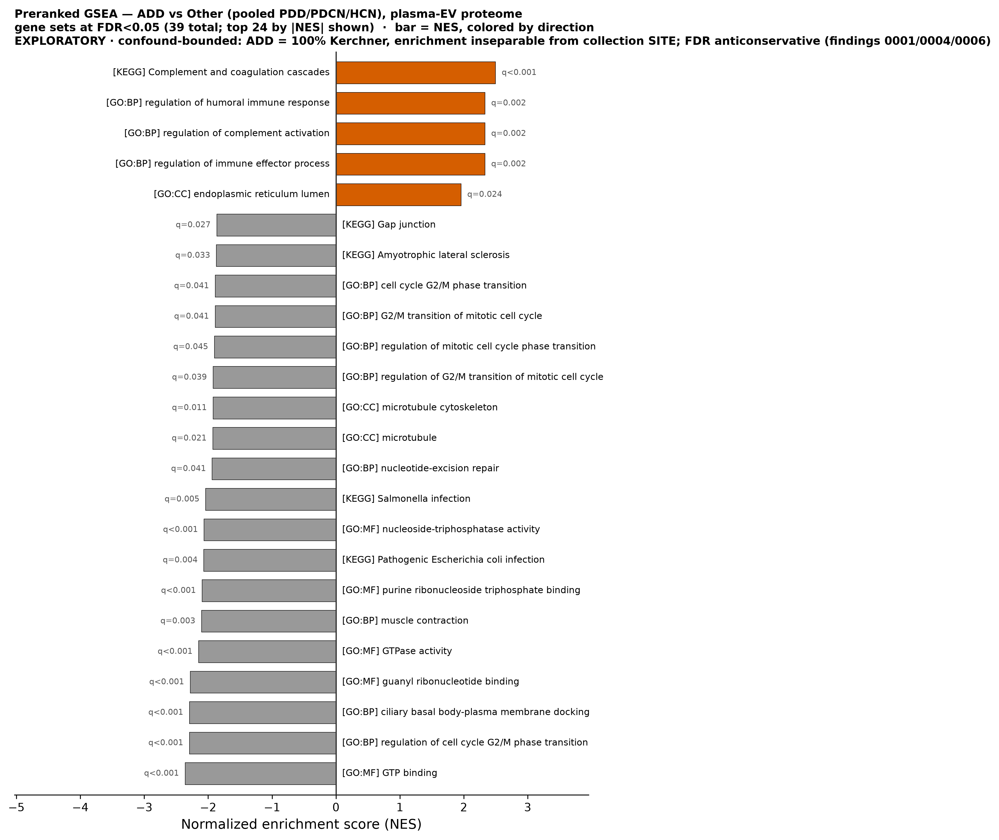
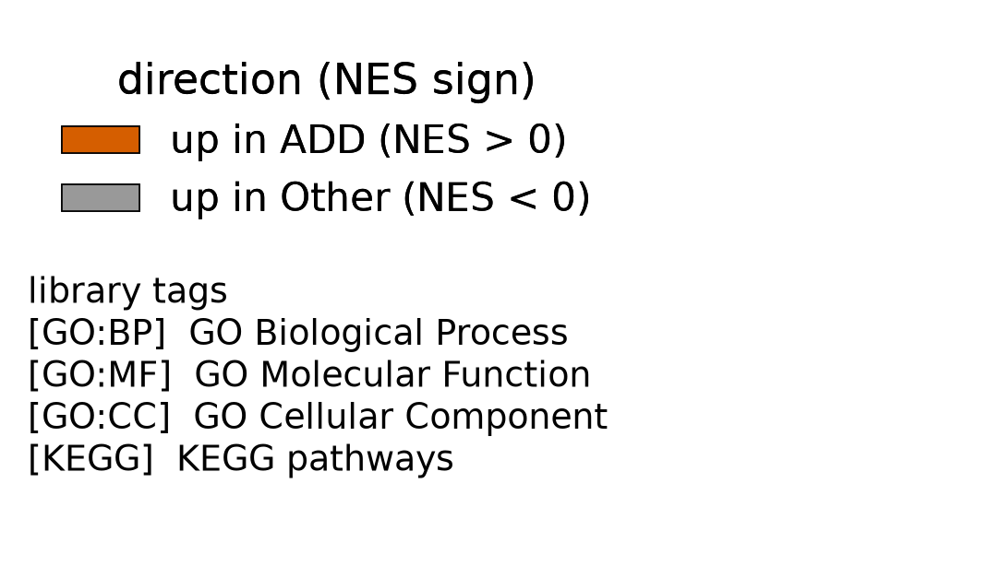
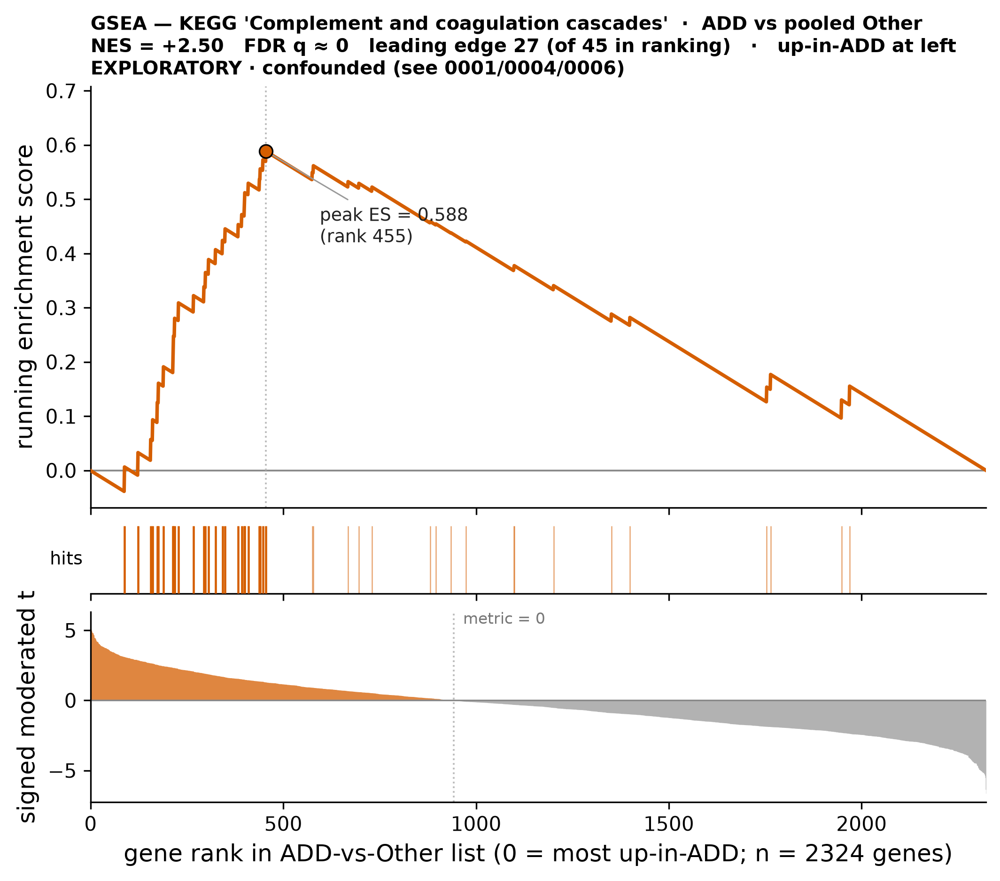
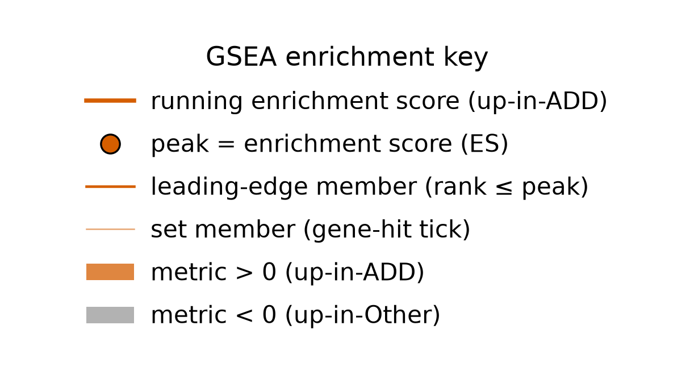

# Abundance-weighted GSEA finds coordinated pathway signal where count-based ORA (0009) found none — an up-in-ADD complement/coagulation + humoral-immune secretory program (up-in-Other GTPase biology) — but the leading theme is a known plasma-collection artifact and the whole result is confound-bounded

> **Scope of this finding (read first).** This is a **preranked GSEA** — a rank-based, abundance/effect-weighted test that ranks **all 2324** symbol-mappable proteins by the signed ADD-vs-Other moderated t and asks whether a pathway's members are **coordinately shifted** toward one end. It is the exact complement to the over-representation analysis in [finding 0009](0009-no-go-kegg-enrichment-add-vs-other.md), which tested only the **discrete 40-protein hit-set** for count enrichment and found nothing. GSEA finding signal where ORA is null is expected when a coordinated *modest* shift is spread across many members. **This is not a disease-biology claim:** the ranking metric is from a site-aliased contrast, the leading up-in-ADD theme is a documented protein-specific plasma pre-analytical sensitivity (collection/handling-artifact-prone, and especially so for EV-isolation carryover of complement in this Mag-Net workflow), and the input variance is anticonservative — read NES / rank order, not the literal q values (see Caveats).

## Summary
Preranked GSEA (gseapy prerank, weighted-KS) over all **2324 symbol-mappable proteins** ranked by the **signed limma moderated t-statistic** (ADD − Other; [finding 0006](0006-add-vs-other-differential-abundance.md)) tests the coordinated, abundance/effect-weighted pathway shift that [finding 0009](0009-no-go-kegg-enrichment-add-vs-other.md) named as untested. Where the count-based ORA of the discrete 40-protein hit-set was completely null (0009: 0 significant terms across GO:BP/CC/MF/KEGG, both directions), GSEA is **richly significant** — **106 gene sets at FDR<0.25 (21 up-in-ADD / 85 up-in-Other) and 39 at FDR<0.05 (9 up-in-ADD / 30 up-in-Other)** across the four libraries, both directions. **Up-in-ADD** is a tight **complement/coagulation + humoral-immune secretory program**: KEGG "Complement and coagulation cascades" (NES=+2.50, FDR q≈0, leading edge 27), GO:BP regulation of complement activation / humoral immune response / immune effector process (NES≈+2.33, FDR q≈0.0022, LE 15), GO:MF serine-endopeptidase + endopeptidase-inhibitor activity, GO:CC ER/Golgi-lumen secretory compartments. **Up-in-Other** is **guanine-nucleotide/GTPase biology**: GTP/guanyl-ribonucleotide binding, GTPase activity (NES −2.15 to −2.36, FDR q≈0), plus cell-cycle G2/M, ciliary basal-body docking, muscle contraction. UniProt→HGNC decode: 2324/2340 accessions mapped (16 unmapped — Ig-variable fragments / non-canonical first-member representatives — dropped), 0 symbol collisions.

## Verdict
This is the **textbook ORA-vs-GSEA divergence**: a coordinated modest shift spread across many pathway members is invisible to a 40-gene hard-threshold count but detectable by a magnitude-weighted rank test — so GSEA answers, **affirmatively, the coordinated-pathway question [0009](0009-no-go-kegg-enrichment-add-vs-other.md) left open.** But it does **NOT** clear the bar for disease biology, for three stacked reasons:

1. **Confound ceiling ([findings 0001](0001-group-aliased-with-cohort.md)/[0004](0004-batch-correction-extrapolated-single-cohort.md)):** the ranking metric derives from a contrast aliased with collection site (ADD 100% Kerchner; batch correction extrapolated for the single-cohort ADD/PDCN arms), and — crucially — the leading up-in-ADD theme, **complement/coagulation, is a documented protein-specific plasma pre-analytical sensitivity** (research corpus [`plasma-complement-coagulation-preanalytical-artifact`](../research/plasma-complement-coagulation-preanalytical-artifact.md)): the coagulation/platelet side is a strongly and repeatedly replicated plasma-proteomics artifact (Geyer 2019 "coagulation panel", pmid:31566909), complement-specific evidence is real but thinner (pmid:27708557, pmid:25780008), and — most directly for this Mag-Net EV/DIA workflow — EV-isolation/centrifugation/storage carryover of complement (esp. C3) is isolation-method-dependent (pmid:41723353, pmid:42669007, pmid:40594329). So the single most significant signal is precisely the one most vulnerable to a collection-site / handling effect. Treat it as **site-plausible until shown otherwise.**
2. **Anticonservative input ([finding 0006](0006-add-vs-other-differential-abundance.md)):** the DE t-statistics inherit the variance deflation of the already-batch-corrected matrix (π0≈0.53), so the **relative ranking stays valid** for GSEA but the many **q≈0 values are not literal near-certainty** — read NES / rank order, discount the exact q magnitudes.
3. **Small-n / exploratory ([finding 0003](0003-contrasts-class-imbalanced-small-n.md)):** n=10 ADD vs 30 Other.

**Not promotable as-is** — the compute script is under `scripts/scratch/` (not code-reviewed/promoted), so this finding cannot be validated until it is reviewed and moved to `scripts/promoted/` (`conventions/findings.md` §2.2, §4).

## Evidence
The central result is that GSEA is **rich where ORA was null.** Splitting the significant sets by library and direction (positive NES = up-in-ADD, negative = up-in-Other):

- **FDR<0.25:** GO:BP +11/−35, GO:MF +5/−19, GO:CC +2/−15, KEGG +3/−16 — 106 sets (21 up-in-ADD / 85 up-in-Other).
- **FDR<0.05:** GO:BP +3/−11, GO:MF +3/−8, GO:CC +2/−3, KEGG +1/−8.
- **Contrast:** ORA ([finding 0009](0009-no-go-kegg-enrichment-add-vs-other.md)) = **0 significant terms in any source, either direction.**

This is *term-level* enrichment evidence (NES + FDR q per set; no per-feature q). The **up-in-ADD** side is a coherent complement/coagulation + humoral-immune secretory program (KEGG "Complement and coagulation cascades" NES=+2.50, FDR q≈0, LE 27; GO:BP regulation of complement activation / humoral immune response / immune effector process NES≈+2.33, FDR q≈0.0022, LE 15), and the **up-in-Other** side is guanine-nucleotide/GTPase biology (GO:MF GTP binding NES=−2.36 FDR q≈0 LE 50; guanyl ribonucleotide binding −2.28; GTPase activity −2.15 LE 58).

The whole significant-set landscape — how many sets pass, in which direction, and which themes dominate each side — is the direct picture of the ORA→GSEA reversal:

*Figure 1. Preranked GSEA NES for FDR<0.05 gene sets, ADD vs pooled Other. Produced by `scripts/figures/plot_gsea_nes_add_vs_other.py` (uncommitted) from `results/gsea/fed7a349c550/gsea_all_libraries.csv`, data `protein-data.csv sha256:90a0462eb03a02bd`, result `fed7a349c550`.*

Read the bars by sign: the **positive (up-in-ADD)** bars are led by KEGG complement/coagulation and the humoral-immune GO:BP program, while the **negative (up-in-Other)** bars are dominated by GTP-binding / GTPase-activity sets — a genuinely two-directional, coordinated landscape that a thresholded count of 40 proteins ([finding 0009](0009-no-go-kegg-enrichment-add-vs-other.md)) could not see at all. That so many sets pass at all — where ORA returned exactly zero — is the ORA-vs-GSEA divergence made visible.

The single strongest signal, KEGG "Complement and coagulation cascades," is best seen as its running enrichment score:

*Figure 2. GSEA running enrichment score for KEGG "Complement and coagulation cascades." Produced by `scripts/figures/plot_gsea_enrichment_complement_coagulation_add_vs_other.py` (uncommitted) from `results/gsea/fed7a349c550/ranked_symbols.csv` + `results/gsea/fed7a349c550/gsea_kegg.csv`, data `protein-data.csv sha256:90a0462eb03a02bd`, result `fed7a349c550`.*

Read the running-ES curve: it climbs steeply near the top of the ranking (the up-in-ADD end) and peaks at NES=+2.50, with 27 leading-edge members clustered there — i.e. the complement/coagulation set is coordinately elevated in ADD rather than driven by one or two proteins. This is exactly the kind of coordinated modest shift a magnitude-weighted rank test detects and a hit-count misses — **and** it is the theme most exposed to the collection-site confound (see Caveats).

The decode is clean: **2324/2340 UniProt accessions mapped to HGNC symbols** (16 unmapped — Ig-variable fragments / non-canonical first-member representatives — dropped, 0.7%), **0 symbol collisions** (the max-|t| dedup fired on nothing). The unreliable entry-name mnemonic was **not** used as symbol (verified, e.g. MP2K2_HUMAN → MAP2K2). This is a count/identifier audit fact and carries no figure.

## Methods / how to produce
The ranking metric is the **signed limma moderated t-statistic** of the ADD-vs-pooled-Other contrast ([finding 0006](0006-add-vs-other-differential-abundance.md); DE table `results/differential_abundance/add-vs-other-moderated/contrast_table.csv`, sha256 59358bf656332dd1), the `statistic` column sorted descending. One scratch script drives it on the delivered analysis matrix (`protein-data.csv sha256:90a0462eb03a02bd`, 40 experimental samples), seed 20260915, adapted from the `enrichment` lib template (v0.1, reusing its signed-off UniProt ID parser):

- `scripts/scratch/gsea_add_vs_other.py` — decodes UniProt accessions to HGNC symbols via `mygene.querymany(scopes=uniprot, fields=symbol, species=human)` (2324/2340 mapped, 16 dropped, 0 collisions), builds the 2324-symbol ranked list, and runs `gseapy` preranked GSEA (weighted-KS) against the Enrichr libraries GO_Biological_Process_2021, GO_Molecular_Function_2021, GO_Cellular_Component_2021, KEGG_2021_Human, with `min_size=15`, `max_size=500`, `permutation_num=1000`. Caches result `fed7a349c550` (`ranked_symbols`, `decode_audit`, `gsea_go_biological_process`, `gsea_go_molecular_function`, `gsea_go_cellular_component`, `gsea_kegg`, `gsea_all_libraries` CSVs, plus `meta.json`).

Software: gseapy 1.3.1; mygene 3.2.2 / biothings_client 0.5.1. The **null is intrinsic to GSEA** — the gene-set permutation (1000 perms) is the honesty control; a classifier-style label-shuffle null is not applicable to a rank test. Figures 1 and 2 render the cached result (`scripts/figures/plot_gsea_nes_add_vs_other.py` from `gsea_all_libraries.csv`; `scripts/figures/plot_gsea_enrichment_complement_coagulation_add_vs_other.py` from `ranked_symbols.csv` + `gsea_kegg.csv`) and recompute no enrichment. The fingerprint, params, and status are registered in `results/manifest.md`.

**Not promotable as-is:** the compute script is under `scripts/scratch/` (not code-reviewed, not promoted), so this finding **cannot be validated** until it is reviewed and moved to `scripts/promoted/` (`conventions/findings.md` §2.2, §4).

## Discussion
The scientific value here is a **method-level resolution** of the open question left by [finding 0009](0009-no-go-kegg-enrichment-add-vs-other.md): does the absence of *count* over-representation in the discrete hit-set mean there is no pathway biology? No — a rank-based, magnitude-weighted GSEA over the full effect-ranked proteome finds a rich, **two-directional, coordinated** pathway landscape. This is the classic ORA-vs-GSEA distinction: a pathway whose members are *each* modestly shifted (below any hit-set threshold) contributes zero to a thresholded count while being strongly coordinated in the ranking. So GSEA answers the coordinated-pathway question affirmatively — but "there is coordinated signal" is a statement about the *ranking*, not about *disease*.

The interpretive weight lands on the leading theme. The single strongest up-in-ADD signal is **complement/coagulation** — and these proteins are a documented, **protein-specific plasma pre-analytical sensitivity**, not a blanket effect (research corpus [`plasma-complement-coagulation-preanalytical-artifact`](../research/plasma-complement-coagulation-preanalytical-artifact.md)). The coagulation/platelet side is the most strongly and repeatedly replicated part — the single most authoritative plasma-proteomics QC study defines a "coagulation panel" (fibrinogen chains, F13A1, SERPINC1, PPBP, GP1BA, THBS1, GP5, PF4V1) and finds coagulation-panel outliers the most frequent quality flag among literature biomarker candidates (Geyer 2019, pmid:31566909). Complement-specific evidence is thinner but real (processing-delay degradome cleavage of C1r/C3/C4, pmid:27708557; anticoagulant- and 37 °C-thaw-dependent complement activation, pmid:25780008 — and notably Geyer's QC panel does not itself flag complement). Most directly for this project, which uses the **Mag-Net EV/DIA** workflow, EV-isolation/centrifugation/storage carryover of complement (especially C3) is isolation-method-dependent rather than a fixed biological readout (same Mag-Net workflow, pmid:41723353; 11-method EV-carryover PC2 = complement/coagulation/lipoprotein, pmid:42669007; ultracentrifugation-vs-SEC complement enrichment, pmid:40594329); magnitude is technique- and variable-dependent (smaller effects seen by MRM / short-delay DIA: pmid:22301387, pmid:22701622, pmid:32445911). Because ADD is 100% Kerchner ([finding 0001](0001-group-aliased-with-cohort.md)) on a matrix whose batch correction is extrapolated for the single-cohort arm ([finding 0004](0004-batch-correction-extrapolated-single-cohort.md)), the most significant biological-looking result is exactly the one a collection-site / handling difference would most plausibly manufacture. The up-in-Other GTPase/guanine-nucleotide biology is a coherent counterpart but sits under the same confound. This is why the honest reading is: **coordinated pathway signal exists and is real in the data, but it is not established as ADD disease biology** — and the leading theme is site-plausible until an unconfounded cohort says otherwise.

## Caveats
- **Confound-bounded — site-aliased ranking metric, and the leading theme is a collection artifact (relates_to [finding 0001](0001-group-aliased-with-cohort.md), [finding 0004](0004-batch-correction-extrapolated-single-cohort.md)).** The GSEA ranking is the signed moderated t of a contrast in which ADD is 100% Kerchner, on an extrapolated-batch-corrected matrix. The single strongest up-in-ADD signal — **complement/coagulation — is a documented protein-specific plasma pre-analytical sensitivity** (strongly replicated on the coagulation/platelet side, thinner but real for complement, and specifically isolation-method-dependent for EV-carryover of complement in this Mag-Net workflow; research corpus [`plasma-complement-coagulation-preanalytical-artifact`](../research/plasma-complement-coagulation-preanalytical-artifact.md)), i.e. the direction most exposed to a collection-site / handling effect. Treat the up-in-ADD program as **site-plausible until shown otherwise.**
- **Anticonservative input — read NES/rank, discount the q magnitudes (relates_to [finding 0006](0006-add-vs-other-differential-abundance.md)).** The DE t-statistics inherit the variance deflation of the already-batch-corrected matrix (π0≈0.53). The **relative ranking remains valid** for a rank test, so GSEA is legitimate, but the many **q≈0 values are not literal near-certainty** — read NES and rank order, not the exact q magnitudes.
- **Small-n, exploratory (relates_to [finding 0003](0003-contrasts-class-imbalanced-small-n.md)).** n=10 ADD vs 30 Other. Never write this up with confirmatory confidence.
- **Live-service mapping.** mygene is a live service, not frozen — the full ACC→symbol map is captured in `results/gsea/fed7a349c550/ranked_symbols.csv` for audit, and the Enrichr `*_2021` libraries are pinned by name/year. A re-run against a later mygene/Enrichr state could differ at the margin.
- **16 proteins dropped** for lack of a mappable symbol (Ig-variable fragments / non-canonical first-member representatives), 0.7% of 2340.
- **Entities not yet attached.** The shared discriminative/leading-edge entity set is not yet normalized to verified UniProt accessions in-project; this must be resolved by the research-reviewer before promotion. (The load-bearing pre-analytical-artifact reference is now attached and fact-checked — see References.)
- **Multiplicity context.** This is one of several Stage-4 analyses on the ADD-vs-Other line; the full set of what was tried and discarded is in `findings/exploration-log.md`.

## Follow-ups
- **Promote the compute script** (`scripts/scratch/gsea_add_vs_other.py` → code review → `scripts/promoted/`) before any validation attempt.
- **Load-bearing reference attached** — complement/coagulation as a protein-specific plasma pre-analytical sensitivity (research corpus `plasma-complement-coagulation-preanalytical-artifact`, references verified). Optionally add a citation for the ORA-vs-GSEA methodological framing if wanted.
- **Normalize the shared entity set** (research-reviewer), across the ADD-vs-Other line ([findings 0006](0006-add-vs-other-differential-abundance.md)/[0007](0007-add-vs-other-classification-confound-bounded.md)/[0008](0008-boruta-all-relevant-add-vs-other.md)/[0009](0009-no-go-kegg-enrichment-add-vs-other.md)/[0010](0010-add-specificity-four-arm-confound-bounded.md)).
- **The one decisive test:** if an unconfounded / different-site ADD cohort becomes available, re-rank and re-run GSEA to test whether the complement/coagulation program survives correction for collection site — the single test that could convert this from confound-bounded to disease-linked.

## Related findings
- **relates_to → [finding 0009](0009-no-go-kegg-enrichment-add-vs-other.md):** the count-based ORA this GSEA is the recorded follow-up to. GSEA answers, affirmatively, the coordinated-abundance-weighted pathway question 0009 explicitly left untested — ORA null (0 terms, all four sources, both directions) → GSEA rich (106 sets FDR<0.25).
- **relates_to → [finding 0006](0006-add-vs-other-differential-abundance.md):** the moderated DE contrast whose signed t-statistic is the GSEA ranking metric; GSEA inherits its anticonservative variance structure (π0≈0.53), so NES/rank order is valid but the q magnitudes are not literal.
- **relates_to → [finding 0001](0001-group-aliased-with-cohort.md):** the confound ceiling — the ranking metric is from a site-aliased contrast (ADD 100% Kerchner), and the leading complement/coagulation theme is the signal most exposed to a collection-site / pre-analytical effect.
- **relates_to → [finding 0004](0004-batch-correction-extrapolated-single-cohort.md):** the extrapolated batch correction that deflates variance → anticonservative t → q≈0 not literal.
- **relates_to → [finding 0003](0003-contrasts-class-imbalanced-small-n.md):** small n (10 ADD vs 30 Other); exploratory.

## References
- **Research corpus [`plasma-complement-coagulation-preanalytical-artifact`](../research/plasma-complement-coagulation-preanalytical-artifact.md)** (status: reviewed; all references fact-checked by the research-reviewer). This is the load-bearing citation for the verdict's claim that the leading up-in-ADD complement/coagulation theme is collection/handling-artifact-prone. The verified, calibrated bottom line: complement/coagulation proteins are a **protein-specific, not blanket**, plasma pre-analytical sensitivity — the coagulation/platelet side is strongly and repeatedly replicated (Geyer 2019 "coagulation panel", pmid:31566909); complement-specific evidence is real but thinner (pmid:27708557 processing-delay degradome of C1r/C3/C4; pmid:25780008 anticoagulant/37 °C-thaw complement activation; Geyer's QC panel does not itself flag complement); and — **most directly relevant to this Mag-Net EV/DIA project** — EV-isolation/centrifugation/storage carryover of complement (esp. C3) is isolation-method-dependent (pmid:41723353 same Mag-Net workflow; pmid:42669007 11-method EV carryover; pmid:40594329 UC-vs-SEC). Magnitude is technique/variable-dependent (smaller effects by MRM/short-delay DIA: pmid:22301387, pmid:22701622, pmid:32445911); hemolysis→complement is an evidence gap. The KEGG hsa04610 members driving this GSEA hit substantially overlap the handling-sensitive set.
- The ORA-vs-GSEA methodological framing (a coordinated modest shift is detectable by a rank test but invisible to a thresholded count) is not yet cited; a citation may be added if wanted.
- Software/tool versions (gseapy 1.3.1; mygene 3.2.2 / biothings_client 0.5.1) are recorded in `provenance`.
</content>
</invoke>
