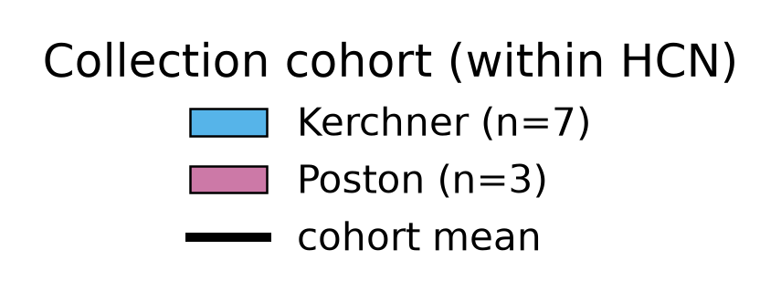

# Within-arm cohort is degenerate in the delivered matrix — collection cohorts have identical per-protein means within every multi-cohort arm, so within-arm site tests are structurally uninformative

## Summary
In the delivered (already **limma-batch-corrected**) 40×2340 log2 matrix, within each diagnostic arm that spans more than one collection cohort the cohort subgroups have **identical per-protein means to machine precision**. Within **HCN** (Kerchner n=7 vs Poston n=3), the maximum absolute per-protein mean difference across all 2340 proteins is **6.75e-14** (mean Δ = 0.0000, median |Δ| = 1.4e-14); within **PDD** (Poston n=7 vs rest n=3) it is identically **6.75e-14** — even though individual samples genuinely differ (within-Kerchner per-protein sd ≈ 0.74). Cohort therefore carries **zero within-arm imprint on abundance given Condition** — it is orthogonal to the data within an arm. (Independently re-derived directly from the loader by the orchestrator: max |Δ| = 6.750e-14, matching the analysis cache.)

## Verdict
This is a **data-integrity property of the delivered matrix** with a direct methodological consequence: **any within-arm cohort/site test in this project is structurally uninformative** — a "no site effect" null within an arm is a **construction artifact**, NOT evidence that site does not matter. Only **cross-arm** cohort contrasts could ever carry a site signal, and those are aliased with Condition ([finding 0001](0001-group-aliased-with-cohort.md)). It **refines the Stage-2 residual-cohort observation** recorded in `state/DATA_DESCRIPTION.md` (HCN residual mean Δ ≈ −0.002; the true value is machine-zero — a stronger, more specific fact) and **sharpens [finding 0004](0004-batch-correction-extrapolated-single-cohort.md)**: the limma `removeBatchEffect` on Cohort removed the within-arm cohort mean difference *exactly*, so within-arm residual site signal is not merely small but **absent by construction**, while the single-cohort ADD/PDCN correction remains *extrapolated* and unverifiable. This likely reflects how this (demo) dataset / its batch correction was constructed; it is recorded as the durable memory of a gotcha that bounds all site reasoning downstream. **Exploratory; not promotable as-is** — the compute script is under `scripts/scratch/`.

## Evidence
The core observation is a machine-precision degeneracy in the delivered matrix. Within **HCN**, subtracting the Kerchner (n=7) and Poston (n=3) per-protein means across all 2340 proteins gives a **maximum |Δ| of 6.75e-14** (mean Δ = 0.0000, median |Δ| = 1.4e-14) — i.e. the two cohort means coincide to floating-point precision. Within **PDD** (Poston n=7 vs the ADRC-PUC/PUC-only rest, n=3) the maximum |Δ| is **identically 6.75e-14**. This is not a row-alignment artifact: individual samples within a cohort genuinely differ (within-Kerchner per-protein sd ≈ 0.74), so the *samples* vary while the *group means* are identical — the signature of a batch correction that has zeroed the within-arm cohort mean difference exactly. The orchestrator independently re-derived the HCN value directly from the loader (max |Δ| = 6.750e-14), matching the cache.

The figure shows both halves of the claim — that samples differ but cohort means do not, and that the per-protein difference is ~0 across the whole proteome:

*Figure 1. Within-arm cohort degeneracy in the delivered batch-corrected matrix. Produced by `scripts/figures/plot_within_arm_cohort_degeneracy.py` (uncommitted) from `results/four_arm_complement/dd884570c4fc/{sample_scores,cohort_orthogonality}.parquet` plus a loader-recomputed signed per-protein Δ (fidelity-gated to the cached max |Δ|), data `protein-data.csv sha256:90a0462eb03a02bd`, result `dd884570c4fc`.*

Read the two panels together: on the left the individual Kerchner and Poston samples scatter apart (the samples are not identical), yet the two cohort-mean markers land on top of each other; on the right the per-protein Kerchner−Poston mean difference piles up at zero, with the largest deviation anywhere in the 2340-protein proteome at 6.8e-14 — floating-point noise. Cohort is orthogonal to abundance *given Condition*, which is exactly why a within-arm site test can return nothing but a construction artifact.

## Methods / how to produce
The diagnostic runs on the delivered analysis matrix `data/protein-data.csv` (`protein-data.csv sha256:90a0462eb03a02bd`, 40 experimental samples × 2340 features, log2, limma-batch-corrected on Cohort — [finding 0004](0004-batch-correction-extrapolated-single-cohort.md)), seed 20260915, adapted from the `differential-abundance` template:

- `scripts/scratch/four_arm_complement.py` — for each multi-cohort arm (HCN: Kerchner vs Poston; PDD: Poston vs rest), subtracts the per-protein group means across all 2340 proteins and reports max |Δ|, mean Δ, and median |Δ|, plus the within-group per-protein sd as the non-degeneracy check. The `cohort_orthogonality` diagnostic (informative flag per arm) is cached. Result `dd884570c4fc` (`cohort_orthogonality`, `within_site_tests`, `sample_scores` parquets + `meta.json`).

Figure 1 renders the cached scores plus a loader-recomputed signed per-protein Δ (`scripts/figures/plot_within_arm_cohort_degeneracy.py`), fidelity-gated to the cached max |Δ|, and recomputes no statistics. The fingerprint, params, and status are registered in `results/manifest.md`.

**Not promotable as-is:** the compute script is under `scripts/scratch/` (not code-reviewed, not promoted), so this finding **cannot be validated** until it is reviewed and moved to `scripts/promoted/` (`conventions/findings.md` §2.2, §4).

## Discussion
The value of this caveat is that it forecloses a tempting but false move: reasoning "there is no residual site effect *within* an arm, so collection site is under control." In this matrix that within-arm null is guaranteed by construction — `removeBatchEffect` on Cohort has driven the within-arm cohort mean difference to machine zero — so it carries no information about whether site matters. The only contrasts in which a site signal could ever surface are **cross-arm** cohort comparisons, and those are precisely the ones aliased with Condition ([finding 0001](0001-group-aliased-with-cohort.md)): ADD is 100% Kerchner, the two PD arms are 0% Kerchner, so a cross-arm site contrast is a disease contrast wearing a different label. There is therefore no design-internal contrast that isolates site from disease. This sharpens rather than lifts [finding 0004](0004-batch-correction-extrapolated-single-cohort.md): for the multi-cohort arms the correction demonstrably removed the within-arm cohort mean difference exactly, but for the single-cohort ADD and PDCN arms the correction is *extrapolated* and cannot be checked this way — there is no second cohort within those arms against which to measure a residual. That the degeneracy is exact (machine precision, not merely small) most plausibly reflects how this demo dataset and its batch correction were constructed; that is a statement about construction, not an external-literature claim.

## Caveats
- **Property of the delivered / batch-corrected matrix only.** The pre-correction matrix is unavailable ([finding 0004](0004-batch-correction-extrapolated-single-cohort.md)), so the *mechanism* (that `removeBatchEffect` on Cohort produced the exact zero) cannot be fully verified in-project — it is inferred from the machine-precision degeneracy plus the known correction.
- **State-file discrepancy flagged for the scientist.** `state/DATA_DESCRIPTION.md` records the within-arm HCN residual cohort mean Δ as ≈ −0.002; the verified value is machine-zero (max |Δ| = 6.75e-14). This is surfaced for the scientist to reconcile in that state file — the findings-manager does **not** edit state files.
- **Does not resolve the design confound.** Within-arm degeneracy is a reason within-arm site tests are uninformative; it is not evidence that site is controlled. The cross-arm site/disease alias ([finding 0001](0001-group-aliased-with-cohort.md)) and the extrapolated single-cohort correction ([finding 0004](0004-batch-correction-extrapolated-single-cohort.md)) both stand.
- **Exploratory; not promotable.** Compute script under `scripts/scratch/`; not code-reviewed. Multiplicity context (this diagnostic is part of the Stage-4 four-arm complement line) lives in `findings/exploration-log.md`.

## Follow-ups
- **Promote `scripts/scratch/four_arm_complement.py`** (code review → `scripts/promoted/`) before any validation attempt.
- **Scientist to reconcile `state/DATA_DESCRIPTION.md`** — update the within-arm residual-cohort number (−0.002 → machine-zero) to match the verified value, if agreed.
- **Flag to the stats-reviewer** that all within-arm cohort/site tests in this project are degenerate by construction, so no within-arm site null should be read as evidence against a site effect.

## Related findings
- **relates_to → [finding 0004](0004-batch-correction-extrapolated-single-cohort.md):** refines/sharpens the batch-correction finding — the limma `removeBatchEffect` on Cohort removed the within-arm cohort mean difference exactly (machine-zero), so within-arm residual site signal is absent by construction rather than merely small; the single-cohort ADD/PDCN correction remains extrapolated and unverifiable.
- **relates_to → [finding 0001](0001-group-aliased-with-cohort.md):** because within-arm cohort is degenerate, only cross-arm cohort contrasts could show a site signal — and those are aliased with Condition, so no design-internal contrast can isolate site from disease.

## References
None asserted. The degeneracy is established directly from the delivered matrix and the loader. The remark that it likely reflects how the demo dataset / its batch correction was constructed is a construction hypothesis, scoped as such in ## Discussion, not an external-literature claim.
</content>
</invoke>
