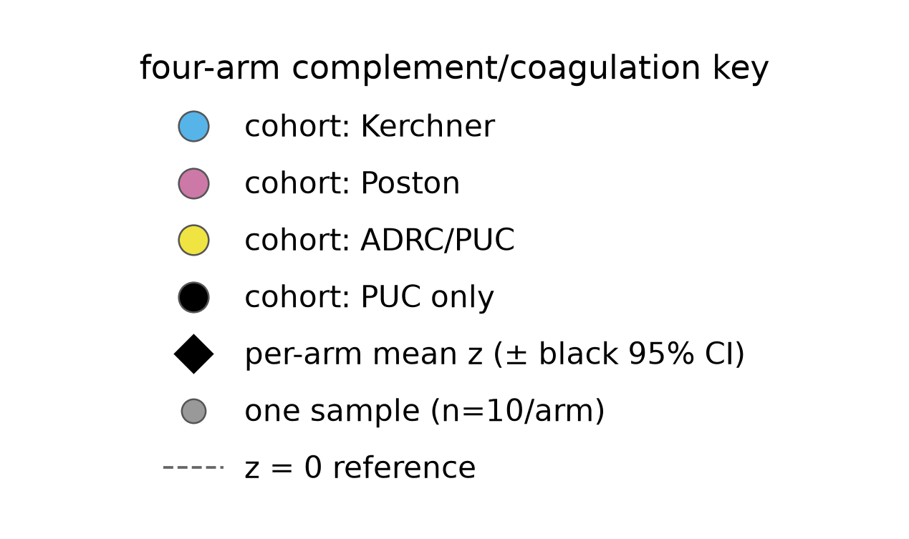

# The up-in-ADD complement/coagulation GSEA program is elevated specifically in the ADD arm — majority-Kerchner HCN sits at baseline — weakly arguing against a pure collection-site artifact, but confound-bounded and not statistically established

## Summary
Profiling the up-in-ADD KEGG **"Complement and coagulation cascades"** leading-edge program (27 proteins from [finding 0011](0011-gsea-add-vs-other-confound-bounded.md); 27/27 mapped into the matrix) across the four arms as **per-sample summary z-scores** shows the program is elevated **specifically in the ADD arm** (mean z **+0.53** [95% CI 0.18, 0.89]) while **PDD** (−0.15 [−0.49, 0.19]), **PDCN** (−0.31 [−0.67, 0.06]) and **HCN** (−0.08 [−0.72, 0.56]) all sit at or below baseline. ADD exceeds PDD (Hedges g **1.33** [0.35, 2.31], BH-q 0.009) and PDCN (g **1.59** [0.57, 2.61], q 0.005) significantly, but **ADD-vs-HCN is not BH-significant** (g **0.80** [−0.11, 1.72], q 0.081). A broader humoral-immune leading-edge union (15 proteins) gives the same picture (ADD-vs-HCN g 0.91 [−0.02, 1.83], q 0.050, borderline). The discriminating observation: **HCN is majority-Kerchner (7/10) yet sits at baseline**, which a pure additive Kerchner collection artifact would not predict.

## Verdict
Read carefully, this **weakly favors** the complement/coagulation program being **ADD-associated rather than a pure Kerchner collection artifact** — its two nearest arms (PDD, PDCN), which are not Kerchner, sit below baseline, and the majority-Kerchner HCN arm is not elevated. That **qualifies (does not overturn)** [finding 0011](0011-gsea-add-vs-other-confound-bounded.md)'s caveat that the leading GSEA theme is collection-artifact-prone. Both sides of that weighing are now literature-grounded (research corpus [`complement-coagulation-alzheimers-blood-csf-biology`](../research/complement-coagulation-alzheimers-blood-csf-biology.md)): an ADD-associated complement/coagulation signal has **real biological precedent** — so it is not dismissable a priori as artifact — while peripheral-**blood** complement as a group is **not** consistently AD-vs-control different across studies, which is itself consistent with the suggestive-not-established reading here. These references bear on biological **plausibility, not on the statistics**. BUT the evidence is **suggestive, not established**, for three stacked reasons: (1) the leading edge is defined from the ADD-vs-Other ranking, so ADD is extreme **by construction** — only the PDD/PDCN/HCN positions are non-circular; (2) the anti-artifact cue rests on HCN-at-baseline, and **ADD-vs-HCN is not BH-significant** (q=0.081); (3) the one **direct** within-arm site probe is **structurally uninformative** here ([finding 0012](0012-within-arm-cohort-degenerate.md) — within-arm cohort is degenerate), so it cannot support "not site," and the core confound is unresolved: ADD is single-cohort, so ADD-disease vs ADD-being-100%-Kerchner is not separable within ADD ([finding 0001](0001-group-aliased-with-cohort.md), [finding 0004](0004-batch-correction-extrapolated-single-cohort.md)). **Exploratory, n=10/arm** ([finding 0003](0003-contrasts-class-imbalanced-small-n.md)). **Not promotable as-is** — the compute script is under `scripts/scratch/`.

## Evidence
Profiling the KEGG-27 complement/coagulation leading-edge program across the four arms gives the central result. The program is **elevated in ADD** (mean summary z **+0.53** [0.18, 0.89]) while **PDD** (−0.15 [−0.49, 0.19]), **PDCN** (−0.31 [−0.67, 0.06]) and **HCN** (−0.08 [−0.72, 0.56]) sit at or below baseline (n=10/arm). The ADD-vs-arm effect sizes (BH over the 3-comparison family) are ADD-vs-PDD g **1.33** [0.35, 2.31] q=0.009 and ADD-vs-PDCN g **1.59** [0.57, 2.61] q=0.005 — both significant — but **ADD-vs-HCN g 0.80 [−0.11, 1.72] q=0.081 is not BH-significant and its CI crosses 0**. The broader humoral-immune leading-edge union (15 proteins, 15/15 mapped) reproduces the pattern: ADD-vs-PDD g 1.29 q=0.012, ADD-vs-PDCN g 1.60 q=0.005, ADD-vs-HCN g 0.91 [−0.02, 1.83] q=0.050 (borderline). Because the leading edge is *defined* by the ADD-vs-Other ranking, ADD is extreme **by construction** — the only **non-circular** readout is **among PDD/PDCN/HCN**, where PDD and PDCN sitting below baseline is the genuine result, and HCN-at-baseline is the anti-artifact cue.

The per-arm profile shows the ADD elevation and the majority-Kerchner-HCN-at-baseline cue directly:

*Figure 1. Per-arm summary z-scores of the up-in-ADD KEGG complement/coagulation leading-edge program across the four arms. Produced by `scripts/figures/plot_fourarm_complement_coag_per_arm_scores.py` (uncommitted) from `results/four_arm_complement/dd884570c4fc/{sample_scores,per_arm_scores,arm_comparisons}.parquet`, data `protein-data.csv sha256:90a0462eb03a02bd`, result `dd884570c4fc`.*

Read the four arms left to right: the ADD mean sits clearly above zero while PDD, PDCN and HCN cluster at or below it, and the cohort coloring shows the crucial point — HCN's majority-Kerchner samples do **not** pull that arm up toward ADD, which a pure additive Kerchner collection artifact would predict. But note the HCN spread is wide (CI −0.72 to 0.56) and ADD-vs-HCN does not reach BH significance, so the cue is weak, not decisive.

## Methods / how to produce
The primary set is the KEGG "Complement and coagulation cascades" **leading-edge** (27 proteins) from the preranked GSEA result `fed7a349c550` ([finding 0011](0011-gsea-add-vs-other-confound-bounded.md)); the secondary robustness set is the GO:BP regulation-of-complement-activation ∪ regulation-of-humoral-immune-response leading-edge union (15 proteins). One scratch script drives it on the delivered analysis matrix `data/protein-data.csv` (`protein-data.csv sha256:90a0462eb03a02bd`, 40 experimental samples × 2340 features), seed 20260915, adapted from the `differential-abundance` template:

- `scripts/scratch/four_arm_complement.py` — for each protein in a set computes a z across all 40 samples, then per sample averages those z-scores into a summary score; per arm (ADD/PDD/PDCN/HCN, n=10 each) it reports the mean summary score with a t 95% CI, and the ADD-vs-arm effect size as Hedges g with a 95% CI (Welch), BH-corrected over the 3-comparison family (ADD vs each of PDD/PDCN/HCN). Caches result `dd884570c4fc` (`sample_scores`, `per_arm_scores`, `arm_comparisons`, `mapping`, `mapping_secondary` parquets + `meta.json`).

Figure 1 renders the cached result (`scripts/figures/plot_fourarm_complement_coag_per_arm_scores.py`) and recomputes no statistics. The fingerprint, params, and status are registered in `results/manifest.md`. This is the **same cached result** that backs the within-arm cohort-degeneracy diagnostic in [finding 0012](0012-within-arm-cohort-degenerate.md).

**Not promotable as-is:** the compute script is under `scripts/scratch/` (not code-reviewed, not promoted), so this finding **cannot be validated** until it is reviewed and moved to `scripts/promoted/` (`conventions/findings.md` §2.2, §4).

## Discussion
[Finding 0011](0011-gsea-add-vs-other-confound-bounded.md) flagged the up-in-ADD complement/coagulation program as its most significant GSEA theme *and* its most suspect one, because complement/coagulation proteins are a documented protein-specific plasma pre-analytical sensitivity (research corpus [`plasma-complement-coagulation-preanalytical-artifact`](../research/plasma-complement-coagulation-preanalytical-artifact.md) — strongly replicated on the coagulation/platelet side, and specifically isolation-method-dependent for EV-carryover of complement in this Mag-Net-class workflow) and ADD is 100% Kerchner. The competing hypothesis this finding entertains — that the signal is genuinely ADD-associated — is not a stretch: an AD-associated complement/coagulation signal has real biological precedent (research corpus [`complement-coagulation-alzheimers-blood-csf-biology`](../research/complement-coagulation-alzheimers-blood-csf-biology.md): complement in AD synaptic pruning, CLU/CR1 as replicated AD GWAS loci, CSF clusterin elevated by meta-analysis, and plasma fibrinogen prospectively predicting incident AD). Importantly, that same literature is candid that peripheral-**blood** complement as a group is **not** consistently different between AD and controls, with individual-protein directionality conflicting across studies — so biological plausibility here does not translate into a strong prior on any single protein, and is fully consistent with a suggestive-not-established verdict. This finding asks the one within-design question that can partly discriminate: if the program were a pure additive Kerchner collection effect, then the other majority-Kerchner arm — HCN, 70% Kerchner — should also be elevated. It is not; HCN sits at baseline, and the two non-Kerchner PD arms sit below baseline while ADD is above. That pattern is more consistent with an ADD-associated program than with a pure site effect, so it **weakly qualifies** 0011's caveat. But three things stop it short of establishing disease biology. First, ADD's elevation is circular: the leading edge was picked *because* those proteins rank up in ADD-vs-Other, so ADD being high is guaranteed and only the other three arms are informative. Second, the informative cross-arm comparison that most matters, ADD-vs-HCN, does not survive BH correction (q=0.081), so the anti-artifact cue is suggestive at best. Third, and most fundamentally, the **direct** test — is there residual within-arm site structure? — is unavailable in this matrix, because within-arm cohort is degenerate by construction ([finding 0012](0012-within-arm-cohort-degenerate.md)): the within-HCN Kerchner-vs-Poston means are identical to machine precision, so no within-arm site contrast can speak to this at all. The ADD single-cohort confound therefore stands ([finding 0001](0001-group-aliased-with-cohort.md), [finding 0004](0004-batch-correction-extrapolated-single-cohort.md)): within ADD, disease and Kerchner-site are the same axis, and only an ADD cohort from a different collection site could break it.

## Caveats
- **ADD is extreme by construction.** The leading edge is defined from the ADD-vs-Other ranking, so ADD scoring high is circular; the only non-circular readout is among PDD/PDCN/HCN. The ADD-vs-PDD / ADD-vs-PDCN effect sizes are not evidence of specificity by themselves.
- **ADD-vs-HCN is not BH-significant (q=0.081).** The anti-artifact cue rests on HCN sitting at baseline despite being majority-Kerchner, but the ADD-vs-HCN comparison fails significance and its CI crosses 0 (g 0.80 [−0.11, 1.72]); the secondary 15-protein set is only borderline (q=0.050). Suggestive, not established.
- **The direct within-arm site probe is uninformative (relates_to [finding 0012](0012-within-arm-cohort-degenerate.md)).** Within-arm cohort is degenerate by construction, so no within-arm site test can support "not site" — the cross-arm composition argument is the only available cue, and it is weak.
- **Confound-bounded — ADD single-cohort (relates_to [finding 0001](0001-group-aliased-with-cohort.md), [finding 0004](0004-batch-correction-extrapolated-single-cohort.md)).** ADD is 100% Kerchner, so ADD-disease vs ADD-Kerchner-site is not separable within ADD; the batch correction is extrapolated for the single-cohort arm and cannot be internally validated.
- **Small-n, exploratory (relates_to [finding 0003](0003-contrasts-class-imbalanced-small-n.md)).** n=10/arm. The multiplicity context (this is part of the Stage-4 four-arm complement line following the GSEA [finding 0011](0011-gsea-add-vs-other-confound-bounded.md)) lives in `findings/exploration-log.md`.
- **Anticonservative source ranking.** The leading edge derives (via GSEA, [finding 0011](0011-gsea-add-vs-other-confound-bounded.md)) from the ADD-vs-Other moderated t-ranking of [finding 0006](0006-add-vs-other-differential-abundance.md), which inherits the variance deflation of the batch-corrected matrix; the leading-edge membership is a rank-order product, read qualitatively. (No typed edge to 0006 is asserted — the dependency is mediated through 0011 — see the report's flag.)
- **Entities not yet normalized.** The 27 leading-edge proteins are mapped symbols in the cache but not normalized to verified accessions in-project; the research-reviewer should normalize + label the set at promotion.

## Follow-ups
- **Promote `scripts/scratch/four_arm_complement.py`** (code review → `scripts/promoted/`) before any validation attempt.
- **References attached** — the pre-analytical/collection-artifact account this finding weighs against (research corpus `plasma-complement-coagulation-preanalytical-artifact`, shared with [finding 0011](0011-gsea-add-vs-other-confound-bounded.md)) and the AD-biology account grounding that an ADD complement/coagulation signal can be real (research corpus `complement-coagulation-alzheimers-blood-csf-biology`); both reviewed and fact-checked. See References.
- **Normalize the leading-edge entities** (verified accessions for the KEGG-27 and humoral-15 sets).
- **Break the ADD-disease-vs-Kerchner-site confound with a different-site ADD cohort.** Profiling this program in an ADD group not drawn from Kerchner is the one test that would convert this from suggestive to established — nothing internal to this design can.

## Related findings
- **relates_to → [finding 0011](0011-gsea-add-vs-other-confound-bounded.md):** the GSEA finding whose up-in-ADD KEGG complement/coagulation leading-edge program this profiles across arms; this qualifies (does not overturn) 0011's collection-artifact caveat.
- **relates_to → [finding 0010](0010-add-specificity-four-arm-confound-bounded.md):** the four-arm ADD-specificity sibling — same per-arm summary-score machinery and design logic, applied to the GSEA leading edge rather than the Boruta-40 signature.
- **relates_to → [finding 0012](0012-within-arm-cohort-degenerate.md):** the within-arm cohort degeneracy that makes the direct within-arm site probe uninformative — the reason this finding stays suggestive.
- **relates_to → [finding 0001](0001-group-aliased-with-cohort.md):** the ADD single-cohort confound — ADD is 100% Kerchner, so disease vs site is unresolved within ADD.
- **relates_to → [finding 0004](0004-batch-correction-extrapolated-single-cohort.md):** the extrapolated batch correction for the single-cohort ADD arm — residual site structure cannot be internally validated.
- **relates_to → [finding 0003](0003-contrasts-class-imbalanced-small-n.md):** small n (10/arm), exploratory.

## References
- **Research corpus [`plasma-complement-coagulation-preanalytical-artifact`](../research/plasma-complement-coagulation-preanalytical-artifact.md)** (status: reviewed; references fact-checked). The pre-analytical/collection-artifact account this finding weighs against, inherited from [finding 0011](0011-gsea-add-vs-other-confound-bounded.md) and shared with it. Verified, calibrated: complement/coagulation is a protein-specific (not blanket) plasma pre-analytical sensitivity — coagulation/platelet side strongly replicated (Geyer 2019 pmid:31566909), complement-specific evidence real but thinner (pmid:27708557, pmid:25780008), EV-isolation carryover of complement (esp. C3) isolation-method-dependent in this Mag-Net-class workflow (pmid:41723353, pmid:42669007, pmid:40594329).
- **Research corpus [`complement-coagulation-alzheimers-blood-csf-biology`](../research/complement-coagulation-alzheimers-blood-csf-biology.md)** (status: reviewed; references fact-checked). Grounds that an ADD-associated complement/coagulation signal has real biological precedent — so it is not dismissable a priori as artifact. Replicated/high-confidence: complement in AD synaptic pruning (pmid:18083105, pmid:27033548); CLU + CR1 replicated AD GWAS risk loci (pmid:19734902, pmid:19734903, pmid:20460622); CSF clusterin elevated by meta-analysis (pmid:31628417); plasma fibrinogen predicts incident AD (pmid:16269641); amyloid-beta activates the plasma FXII contact system (pmid:25775543). Honesty caveat: peripheral-blood complement as a group is NOT consistently AD-vs-control different (pmid:31628417), individual-protein directionality conflicts — so individual-protein claims stay provisional. Bears on biological plausibility, **not** on this finding's statistics (ADD-vs-HCN remains q=0.081, n.s.).
- The GSEA source software/versions are recorded in [finding 0011](0011-gsea-add-vs-other-confound-bounded.md)'s provenance.
</content>
